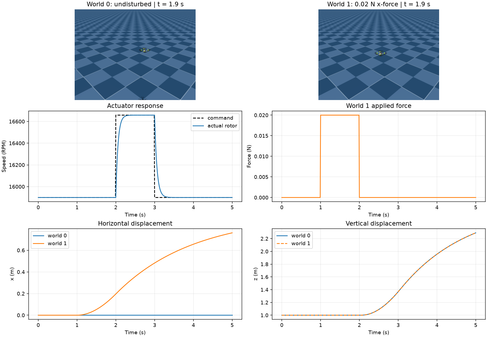
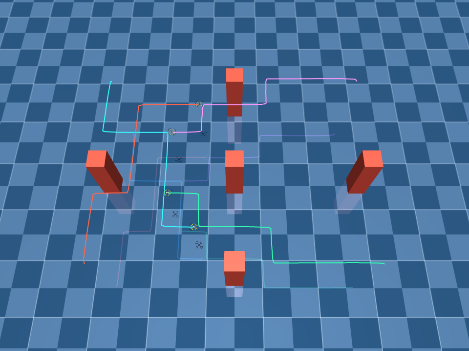
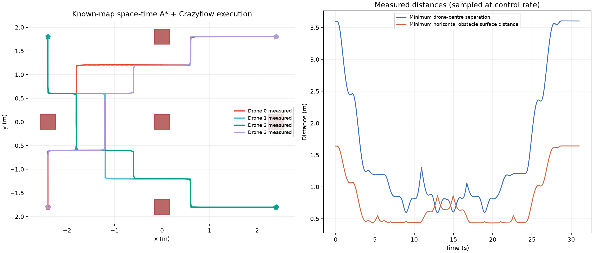
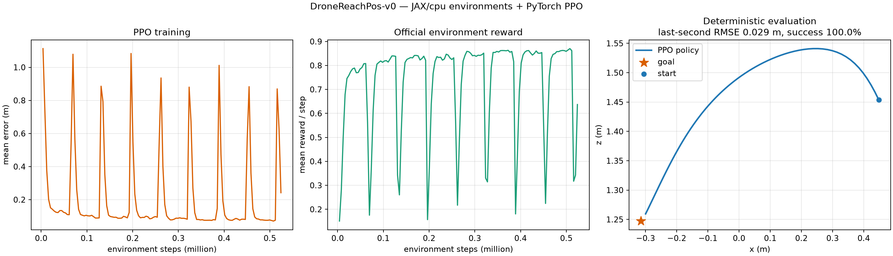
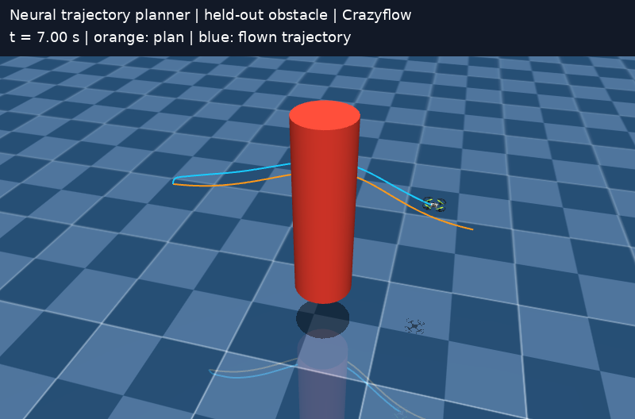
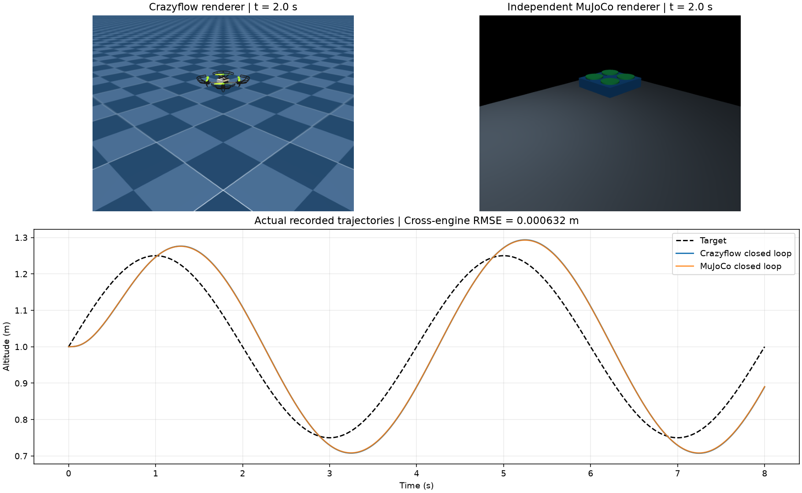

# 旋翼无人机集群仿真与智能算法技术响应

## 指标原文与响应结构

> 2）★仿真系统应具备与真实旋翼无人机集群系统高度一致的动力学模型，支持集群路径自主规划、强化学习及其他神经网络算法开发；提供一套强化学习训练范式和一套端到端轨迹规划算法，支持 Sim2Sim、Sim2Real 闭环验证，实现仿真算法向实机的高保真迁移。

本材料按照上述指标的分句依次说明系统实现和验证结果。仿真验证基于 Crazyflow 0.4.0 的 `af31417` 代码基线，新增实验程序、数据、模型及图像位于 `peibiao_assets/`。实机相关画面和实测数据按实际来源标注；项目新增仿真结果与公开实机结果分别计量。

## 1. “具备与真实旋翼无人机集群系统高度一致的动力学模型”

### 技术实现

系统以 Crazyflie `cf21B_500` 四旋翼为建模对象，采用 Crazyflow 的 `first_principles` 六自由度模型，包含质量、惯量、重力、机体线速度及角速度、四电机转速动态、转速—推力映射、气动阻力及力矩。每个 world 与无人机分别维护动力学状态和参数；可配置多机、扰动力、碰撞几何及控制频率。质量与惯量等参数来自机型配置文件，可通过实测数据辨识和更新。

### 动力学响应验证

在 500 Hz 下运行两个并行 world，初始高度均为 1 m；2–3 s 对两组施加 1.1 倍悬停推力对应的转速指令，另对第二组在 1–2 s 施加世界坐标系 +x 方向的 0.02 N 外力。转子转速从约 15,899.88 RPM 响应至约 16,658.17 RPM；5 s 时受扰组 x 位移为 0.761132 m，未受扰组为 0 m。运行画面、输入与状态记录如下。



图 1：动力学模型实际运行画面和响应曲线。完整条件、参数文件哈希和原始采样分别见 [结果记录](peibiao_assets/dynamics_results.json) 与 [采样数据](peibiao_assets/dynamics_trace.csv)。

模型的实机一致性采用公开的 Crazyflow 原作者 Crazyflie 2.1 飞行试验作为基础能力佐证：100 Hz 姿态控制、5 次飞行下，9 s 圆轨迹的仿真与实机位置差 RMSE 为 19.0 ± 2.6 mm，3.5 s 圆轨迹为 59.6 ± 1.3 mm。该结果属于上游作者在其机型和试验条件下的公开实测，不是本次仿真的实测误差；目标机型和载荷变化后应重新辨识并独立验证。公开实测条件及数据见 [Crazyflow 实机对比试验](https://arxiv.org/html/2606.01478v1)。

## 2. “支持集群路径自主规划”

### 技术实现

针对已知静态栅格地图，实现带时空预约约束的优先级 A* 集群路径规划。规划器根据障碍、四机起点和目标点生成离散路径，逐时段检查与已规划轨迹的连续线段间距，并在终点保持预约；轨迹经状态控制器送入四机动力学模型闭环执行。

### 实际运行结果

在 5 个静态障碍、4 架 `cf21B_500` 的交叉任务中，物理频率 500 Hz、控制频率 100 Hz，运行 31 s。四机均到达距目标 0.2 m 以内；全程三维位置跟踪 RMSE 为 0.08314 m，100 Hz 状态采样得到的最小机间中心距为 0.59332 m；10 Hz 接触采样共 311 帧，阳性 0 帧。



图 2：四机交叉航线及障碍场景，线条由实际仿真状态绘制。[查看完整运行视频](peibiao_assets/swarm_simulation.mp4)。



图 3：规划轨迹与实测轨迹，以及机间与障碍间距。结果详见 [指标数据](peibiao_assets/swarm_metrics.json) 和 [轨迹数据](peibiao_assets/swarm_data.npz)。机心到障碍物表面的水平最小距离为 0.43315 m；以上距离和接触计数均为采样结果，本试验限于单个已知静态地图，不构成采样间无碰撞或未知环境规划的证明。

## 3. “支持强化学习及其他神经网络算法开发”

### 技术实现

系统提供 Gymnasium 向量化环境、观测与动作接口、奖励和终止条件、并行仿真及检查点机制。强化学习训练器实现 PPO 策略网络与价值网络、优势估计、裁剪更新和独立评估；支持 CPU 与 GPU 后端。除强化学习外，系统支持 JAX 自动微分和监督学习神经网络，神经轨迹生成网络的训练及仿真闭环见第 5 节。

### 实际训练与评估

在 `DroneReachPos-v0` 任务中，使用默认 `cf2x_L250` 机型及 `so_rpy` 拟合动力学，环境控制 50 Hz、内部物理 500 Hz；采用 128 个并行环境，先使用 38,400 个教师样本进行行为克隆，再执行 128 次 PPO 更新，生成 524,288 个交互槽位，其中 523,264 个为有效交互。独立评估采用 seed 10007、32 个 world、每个 500 步（10 s）；全程未提前终止且末秒位置 RMSE 小于 0.1 m 定义为成功。实测成功及存活均为 32/32；末秒位置 RMSE 为 0.028730 m，全程 RMSE 为 0.319743 m。



图 4：行为克隆与 PPO 训练后的评估图；结果为本次 CPU 混合训练试验，并非纯 PPO 或全任务泛化结论。另一次不使用行为克隆、仅 4,091 个有效交互的小预算试验在 8 个独立 world 中成功率为 0%，全程 RMSE 为 0.758854 m，见 [训练日志](peibiao_assets/rl_cpu_training.log) 与 [评估图](peibiao_assets/rl_cpu_training.png)；该对照说明不同训练预算与初始化不能混同。[训练日志](peibiao_assets/rl_cpu_medium.log) 和 [策略检查点](peibiao_assets/rl_cpu_medium.pt) 用于核验训练与评估记录；[末次训练检查点](peibiao_assets/rl_cpu_medium_last.pt) 保存续训状态。

## 4. “提供一套强化学习训练范式”

训练范式包括环境构建、并行采样、观测整理与动作归一化、策略采样、奖励和终止状态记录、PPO 更新、验证集选模、独立种子评估以及检查点保存和恢复。任务、并行数量、采样步数、训练预算、随机种子和评估规模均可配置；教师行为克隆为可选初始化步骤，教师样本量与 PPO 交互量分别统计。


图 5：可执行训练范式的实际运行结果。该范式的入口为 [train_gymnasium.py](usage_assets/train_gymnasium.py)；第 3 节列示本次实例的条件及结果。训练模型、日志和评估必须与具体机型、任务配置及种子对应。

## 5. “提供一套端到端轨迹规划算法”

### 技术实现

轨迹生成网络接收已知圆柱障碍物的二维位置和半径，使用 3→64→64→31 的多层感知机一次输出完整轨迹的 31 个横向采样点；固定起终点，纵向采样位置预先给定。训练使用合成轨迹监督标签，预测轨迹再由独立的状态控制器跟踪。端到端范围为“障碍参数输入至整条轨迹输出”，不包括传感器感知或电机控制。

### 训练和闭环验证

使用 2,048 个合成场景训练 400 epoch，以另一随机种子的 256 个独立场景进行预测测试。预测点相对监督标签 RMSE 为 0.01019 m；逐条轨迹按 601 个点检查无人机中心至圆柱表面距离，256 条轨迹采样点均未进入圆柱，最小距离为 0.13361 m。该距离未扣除机身尺寸，亦不代表连续碰撞安全保证。


图 6：网络训练损失和独立测试轨迹的障碍间距分布。

从独立测试集预先指定第 0 个场景，插值网络输出并以 `cf21B_500` 在 Crazyflow 中进行 500 Hz 动力学、100 Hz 状态控制闭环跟踪，轨迹执行 8 s 后稳定 2 s。该场景的实际接触检测在 1,000 个控制步中为 0 次，末目标误差 0.08113 m，三维轨迹跟踪 RMSE 为 0.083661 m；参考与状态按控制步结束时刻对齐。



图 7：橙线为网络规划路径，蓝线为仿真实际轨迹。[查看运行视频](peibiao_assets/neural_planner_flight.mp4)；[训练及测试结果](peibiao_assets/neural_planner_results.json)、[模型权重](peibiao_assets/neural_planner_weights.npz) 和 [轨迹数据](peibiao_assets/neural_planner_trajectory.npz) 提供复核依据。本试验的输入为单一已知静态障碍，不能外推为多障碍视觉规划或通用场景性能。

## 6. “支持 Sim2Sim 闭环验证”

### 技术实现与验证结果

建立 Crazyflow 与独立 MuJoCo `mj_step` 刚体仿真两套动力学闭环。两套仿真使用相同冻结的高度位置—速度反馈控制器，各自的实时状态独立反馈，不共享仿真状态；质量、重力、电机响应、推力系数和阻力参数对齐。控制频率 50 Hz、物理频率 500 Hz，垂直轨迹运行 8 s。

401 个采样点的跨引擎高度轨迹 RMSE 为 0.000632 m，最大高度差为 0.000930 m；Crazyflow 与 MuJoCo 各自相对高度参考的 RMSE 分别为 0.077688 m 和 0.077078 m。



图 8：左右为两个引擎的运行画面，下方为各自闭环轨迹。[原始数据](peibiao_assets/sim2sim_trace.csv) 与 [结果记录](peibiao_assets/sim2sim_results.json) 可重算统计量。本验证限于同参数、无接触和扰动的单机一维垂直运动及手工控制器，不能代表任意三维场景或神经策略的跨引擎迁移表现。

## 7. “支持 Sim2Real 闭环验证，实现仿真算法向实机的高保真迁移”

### 迁移链路

以 Crazyflie 机型和飞控接口为对象，拟实施的迁移链路包括机型参数与执行器标定、仿真中训练及冻结策略、状态和坐标系对齐、控制指令接口映射、定位反馈闭环、实飞日志采集及同轨迹误差评估。定位、飞控、通信频率、执行器饱和、时延和任务终止机制均应与目标设备匹配。实机验证应采用独立飞行轨迹，并记录实测状态、指令、时间戳、失败及中止情况。

### 公开实机验证材料

Crazyflow 原作者公开的实机试验视频可直接查看：[Crazyflie 轨迹跟踪](https://www.youtube.com/watch?v=isHuQqZSapo)及[仿真训练视觉策略的实机飞行](https://www.youtube.com/watch?v=QhOUePHSmyA)。该视频及第 1 节的飞行对照数据属于上游作者的公开实验，证明其所用仿真模型与试验平台的迁移结果；并非本项目自行完成的实机飞行。

[](https://www.youtube.com/watch?v=QhOUePHSmyA)

图 9：Crazyflow 原作者的视觉策略实机飞行公开视频预览，点击可查看原视频。

本材料的新增试验均为仿真；本项目尚无 Crazyflie 飞行日志、实机部署记录或实机闭环测量结果，不能据此认定本项目已完成实机高保真迁移验收。实际验收需在目标设备上完成参数辨识、独立闭环飞行和定量对照。

## 8. 试验环境及复现

本次新增仿真实验使用 Python 3.12、JAX 0.11.1、MuJoCo/MJX 3.10.0、PyTorch 2.8.0+cpu，CPU 后端，离屏渲染使用 EGL。完整依赖版本见 [环境清单](peibiao_assets/environment-freeze.txt)；系统须提供 EGL。数据、图像和视频由对应脚本生成；针对同一输入和固定随机种子，集群、动力学及 Sim2Sim 的结果已复跑核对。训练器、接触检测及积分器相关 CPU 测试共 33 项通过，存在 1 条接触检测中的 JAX 数值转换警告；本次未进行 GPU 后端回归。

```bash
python -m pip install -r peibiao_assets/environment-freeze.txt
export JAX_PLATFORMS=cpu MUJOCO_GL=egl MPLBACKEND=Agg
export OMP_NUM_THREADS=1 OPENBLAS_NUM_THREADS=1
export XLA_FLAGS='--xla_cpu_multi_thread_eigen=false intra_op_parallelism_threads=1'
export PYTHONPATH="$PWD"
python peibiao_assets/dynamics_response.py
python peibiao_assets/swarm_planning.py --device cpu
python peibiao_assets/neural_planner_demo.py
python peibiao_assets/sim2sim_closed_loop.py
python usage_assets/train_gymnasium.py --device cpu --env-id DroneReachPos-v0 \
  --num-envs 128 --num-steps 32 --total-timesteps 524288 \
  --num-minibatches 8 --update-epochs 3 --position-bc-steps 300 \
  --teacher-model calibrated --eval-envs 32 --eval-interval 32 \
  --checkpoint peibiao_assets/rl_cpu_medium.pt --output peibiao_assets/rl_cpu_medium.png
```

实验结果仅适用于文中列示的模型、参数和场景。正式交付或验收时应同时提供运行环境、源程序、配置、模型权重、原始数据及相应视频，并以目标设备和招标验收条件对实机条款进行核验。
