# 旋翼无人机集群仿真与智能算法技术响应方案

## 技术指标与响应安排

> 2）★仿真系统应具备与真实旋翼无人机集群系统高度一致的动力学模型，支持集群路径自主规划、强化学习及其他神经网络算法开发；提供一套强化学习训练范式和一套端到端轨迹规划算法，支持 Sim2Sim、Sim2Real 闭环验证，实现仿真算法向实机的高保真迁移。

本方案按照“动力学建模—集群规划—算法开发—强化学习训练—神经轨迹规划—跨仿真器验证—虚实迁移”的技术链路，逐项给出实现方法、运行画面与量化结果。各项要求与正文的对应关系如下。

| 甲方要求 | 技术响应 | 直接展示的运行证据 |
|---|---|---|
| 真实旋翼无人机集群动力学模型及一致性 | 六自由度模型、电机响应、外力扰动及机群气动作用 | 动力学输入与响应曲线、近地与下洗对照、公开实机一致性数据 |
| 集群路径自主规划 | 已知地图下的多机时空预约规划及闭环执行 | 四机绕障、交叉飞行、抵达目标的连续画面和间距记录 |
| 强化学习及其他神经网络算法开发 | 并行环境、策略网络、价值网络与监督学习网络 | 实际训练曲线、独立场景测试及保存模型的飞行重放 |
| 一套强化学习训练范式 | 环境采样、训练更新、验证选模、独立评估及模型保存 | 行为克隆与 PPO 训练记录、32 个独立环境评估和策略飞行 |
| 一套端到端轨迹规划算法 | 从障碍参数直接生成整条轨迹的神经网络 | 网络训练、独立场景输出、绕障飞行及规划—执行轨迹对照 |
| Sim2Sim 闭环验证 | 同一控制器在两个独立动力学引擎中分别闭环 | 双引擎画面、各自状态反馈和轨迹误差曲线 |
| Sim2Real 闭环验证及高保真迁移 | 虚实接口与部署方案、原作者公开实飞验证 | 原作者公开的实物轨迹跟踪、离手恢复与空中稳定画面 |

文中新增试验均由实际程序运行产生；实机画面采用 Crazyflow 原作者公开飞行资料，并在图内注明归属。本项目新增仿真结果与公开实机结果使用各自的试验条件和统计口径。

## 一、机群动力学建模与物理响应

针对真实旋翼无人机集群的动力学建模要求，系统采用 Crazyflow 六自由度模型，维护每架无人机的位置、姿态、线速度、角速度及四电机状态。模型包含质量、惯量、重力、电机转速动态、转速—推力映射、阻力及外力矩；可按机型配置参数，并在同一场景中组织多机仿真。

以 Crazyflie 2.1 Brushless 的 `cf21B_500` 模型开展输入—响应试验：两个并行环境均以 500 Hz 运行，初始高度 1 m；2—3 秒施加 1.1 倍悬停推力对应的电机转速指令，另对受扰组在 1—2 秒施加 0.02 N 水平外力。

**图 1　动力学模型的实际运行与输入—响应关系。** 上方为两组仿真机体近景，下方依次给出指令与电机响应、外力输入、水平位移及高度变化。转速由约 15,899.88 RPM 向 16,658.17 RPM 过渡；5 秒时受扰组水平位移为 0.761132 m，基准组为 0 m。

### 近地增升与机间下洗

为验证机群模型中的气动作用，显式启用已有地效、下洗插件开展独立对照。近地试验从 0.05 m 高度开始，基准与地效组保持相同的 15,899.878 RPM 转速；2 秒后基准高度为 0.050000 m，地效组为 0.244651 m，附加升力峰值为 0.016725 N。

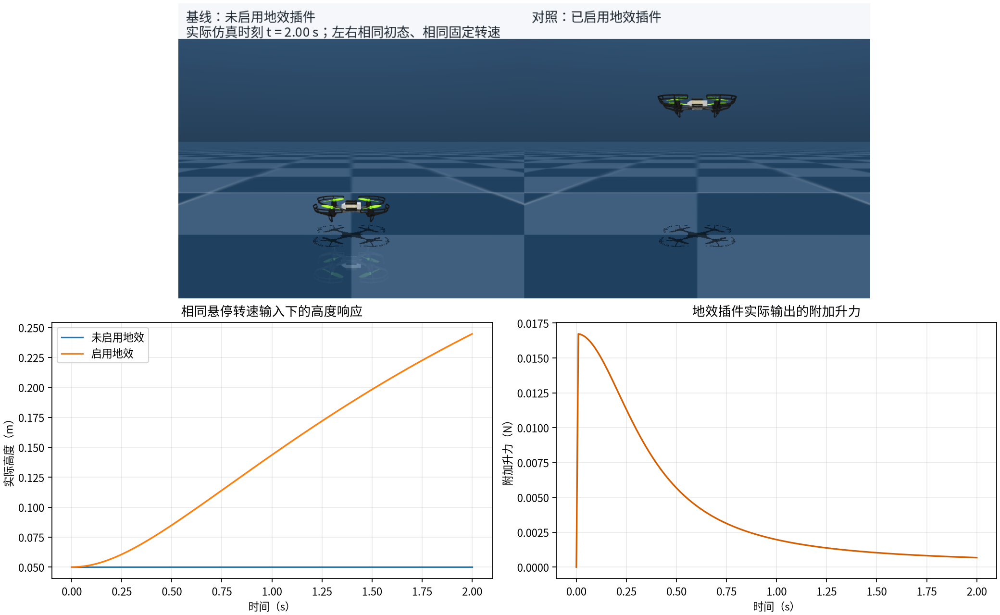

**图 2　地效插件启用前后的实际对照。** 两组初始状态和固定转速相同，画面及曲线显示近地附加升力对高度响应的影响。

<video controls preload="metadata" width="100%" poster="peibiao_assets/aerodynamics/ground_effect_scene.png" src="peibiao_assets/aerodynamics/ground_effect.mp4"></video>

动画演示：同转速下的近地增升

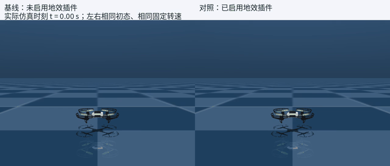

下洗试验中，上机高度指令为 1.2 m，下机为 0.5 m；下机在 4—8 秒以 0.25 m/s 从上机下方穿越。基准与下洗组采用相同初态和位置指令，各自独立反馈；启用下洗后，下机向下附加力峰值为 0.198520 N，与基准组的最大高度差为 0.075791 m。

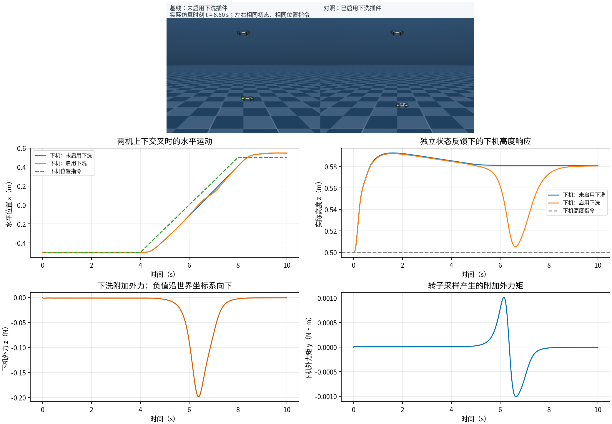

**图 3　机间下洗引起的受力和闭环高度变化。** 上方为 6.6 秒的实际双机画面，下方为位置、向下外力和附加力矩记录。该图证明已启用的经验下洗模型在本场景中的作用；本节气动对照与第二节基础动力学下的四机规划试验分别计量。

<video controls preload="metadata" width="100%" poster="peibiao_assets/aerodynamics/downwash_scene.png" src="peibiao_assets/aerodynamics/downwash_comparison.mp4"></video>

动画演示：上下双机穿越的下洗对照

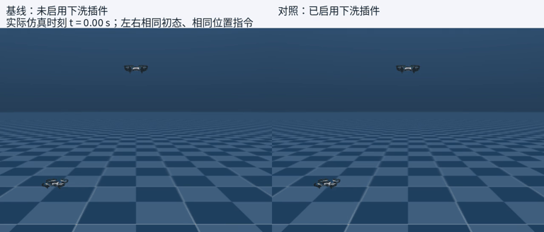

实机一致性另有公开实测支撑：Crazyflow 原作者对 Crazyflie 2.1 进行 100 Hz 姿态控制、每个条件 5 次飞行的仿真—实机对照，9 秒圆轨迹的位置差 RMSE 为 **19.0 ± 2.6 mm**，3.5 秒圆轨迹为 **59.6 ± 1.3 mm**。该数据说明其标定机型及工况下的基础模型一致性；本次多机仿真与该公开单机试验分别报告，不将二者合并为本项目的实机测试。

## 二、多机协同航迹规划与避障执行

针对集群路径自主规划要求，实现带时空预约约束的优先级 A* 规划器。输入为已知静态地图、各机起点和目标；规划过程中避开障碍、检查与已规划无人机的同步线段间距，并预约终点占用时段。生成的路径经状态控制器送入四机动力学模型，形成“规划—控制—状态反馈”的闭环。

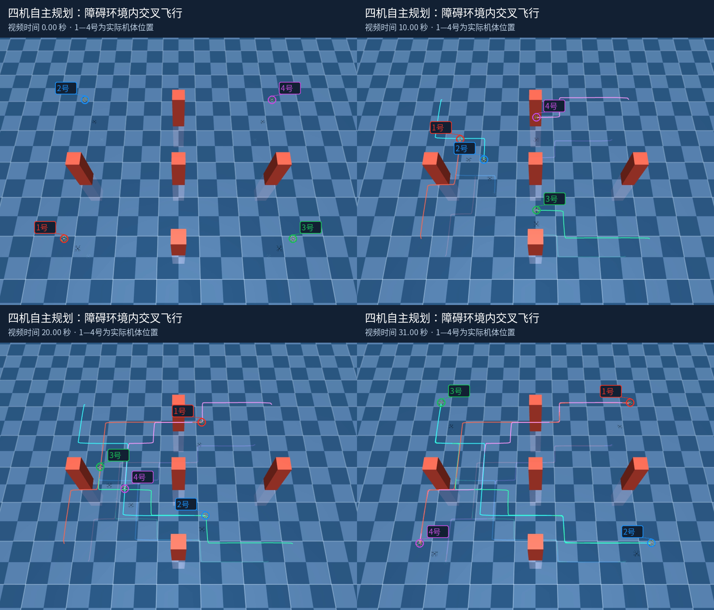

**图 4　四机集群自主规划的执行过程。** 图中标注 1—4 号无人机，取自同一次运行的连续时刻；障碍物、实际机体位置及已飞轨迹均来自仿真画面。

<video controls preload="metadata" width="100%" poster="peibiao_assets/presentation/swarm_replay.png" src="peibiao_assets/presentation/swarm_zh.mp4"></video>

动画演示：四机交叉飞行全过程

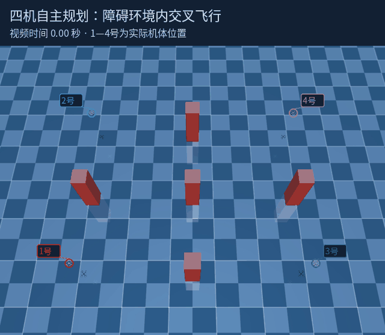

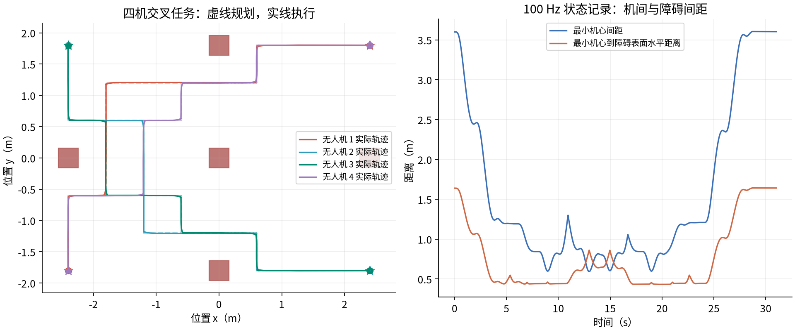

**图 5　规划结果与执行效果的量化对照。** 虚线为规划航线，实线为实际航线；右侧为 100 Hz 状态记录计算的距离。

| 试验条件及结果 | 实际记录 |
|---|---|
| 场景规模与运行时间 | 4 架无人机、5 个静态障碍、31 秒 |
| 物理与控制频率 | 500 Hz / 100 Hz |
| 目标到达 | 4/4 架最终位置距目标小于 0.2 m |
| 全程位置跟踪 RMSE | 0.08314 m |
| 最小机心间距 | 0.59332 m |
| 最小机心至障碍表面水平距离 | 0.43315 m |
| 接触检测 | 10 Hz 共 311 帧，接触阳性 0 帧 |

上述结果对应已知静态场景；距离和接触检测为所列频率下的采样结果。

## 三、强化学习与神经网络算法开发环境

针对强化学习及其他神经网络算法开发要求，系统提供向量化环境、固定顺序的观测接口、动作归一化、奖励与终止条件，以及模型保存和加载能力。PPO 使用策略网络和价值网络进行采样与更新；JAX 自动微分与监督学习接口支持直接训练轨迹生成网络。

本次实际训练的神经规划网络采用 **3→64→64→31** 结构，以障碍物位置和半径为输入，以整条路径的采样点为输出。训练场景与测试场景采用独立随机种子；损失曲线和测试结果均由训练记录生成。

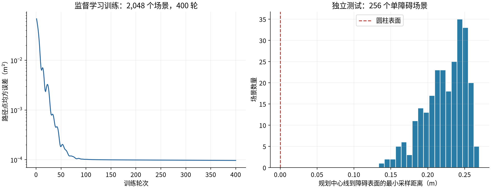

**图 6　神经网络开发与独立测试的实际结果。** 左侧记录 2,048 个合成场景、400 轮训练的路径点损失；右侧为 256 个独立测试场景的规划中心线间距分布。该图对应已知单圆柱障碍、固定起终点的监督学习任务，具体绕障执行见第五节。

## 四、强化学习训练范式与策略闭环飞行

针对完整强化学习训练范式要求，已运行“环境构建—并行采样—优势估计—PPO 裁剪更新—验证选模—独立评估—模型保存”的完整流程。支持可选教师初始化、训练预算配置、检查点重载及续训；教师样本与强化学习有效交互分别计量。

本次到点任务使用 `cf2x_L250` 机型和 `so_rpy` 拟合动力学，内部物理 500 Hz、环境控制 50 Hz。128 个并行环境先使用 38,400 个教师样本初始化，再执行 128 次 PPO 更新，产生 524,288 个交互槽位、523,264 个有效交互。

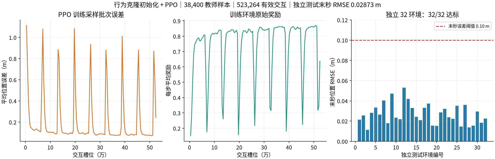

**图 7　实际训练与独立测试。** 左、中图来自保存的训练历史，按包含环境重置的采样批次统计；右图来自冻结模型的独立重放。32 个测试环境均完整运行 500 步，且末秒位置 RMSE 小于 0.1 m，**32/32 达标**；末秒聚合 RMSE 为 **0.028730 m**，含初始接近阶段的全程 RMSE 为 **0.319743 m**。

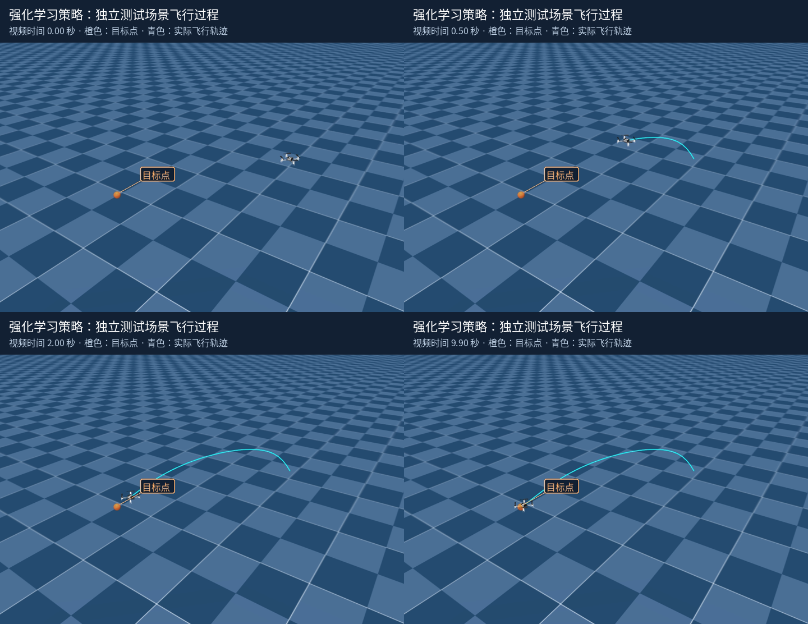

**图 8　训练后策略的实际物理闭环重放。** 橙色为目标点，青色为实际飞行轨迹；画面显示无人机逐步接近目标并稳定。该重放读取保存的模型，使用独立种子 10007 和各环境自身状态反馈，测得指标与原评估一致。

<video controls preload="metadata" width="100%" poster="peibiao_assets/presentation/rl_policy_replay.png" src="peibiao_assets/presentation/rl_policy_replay.mp4"></video>

动画演示：冻结策略从初态飞向目标并保持

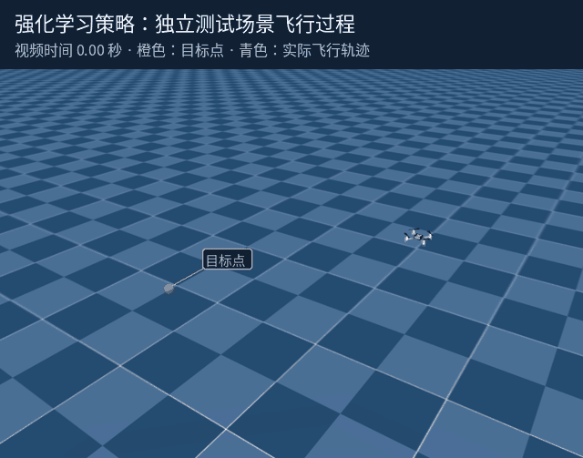

该结果为教师初始化与 PPO 的混合训练实例。另一次不使用教师初始化、仅 4,091 个有效交互的小预算试验，8 个独立环境的成功率为 0%；不同初始化方式与预算的结果分别保留，不能据此合并为纯 PPO 性能。

## 五、神经网络端到端轨迹生成与绕障验证

针对端到端轨迹规划算法要求，采用从障碍参数直接输出整条路径的神经网络：输入圆柱中心位置与半径，单次前向计算输出 31 个路径点的横向坐标，纵向坐标及起终点固定。输出轨迹经插值后交由独立状态控制器执行，端到端范围为**障碍参数至完整轨迹**。

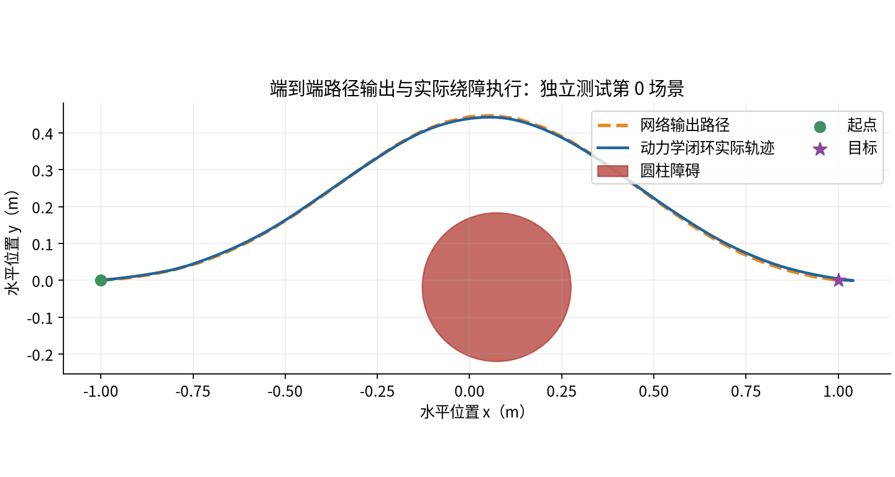

**图 9　规划输出与动力学执行结果。** 橙色虚线为网络输出路径，蓝线为实际执行轨迹；圆形区域为障碍横截面。测试场景在执行前指定，不依据飞行结果挑选。

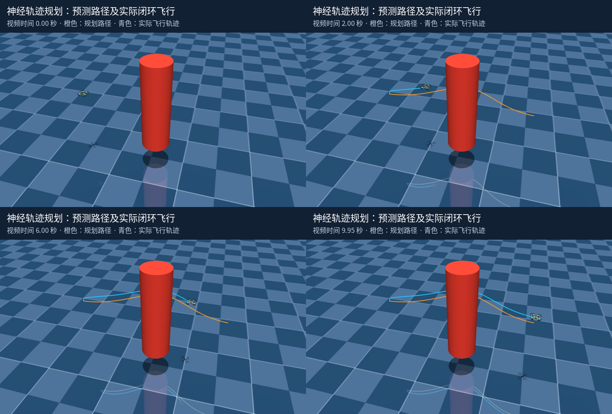

**图 10　神经规划轨迹的实际绕障飞行。** 连续画面显示无人机由起点出发、绕过圆柱并抵达目标；路径与机体运动均来自仿真运行。

<video controls preload="metadata" width="100%" poster="peibiao_assets/presentation/neural_planner_replay.png" src="peibiao_assets/presentation/neural_planner_zh.mp4"></video>

动画演示：网络输出轨迹的实际绕障执行

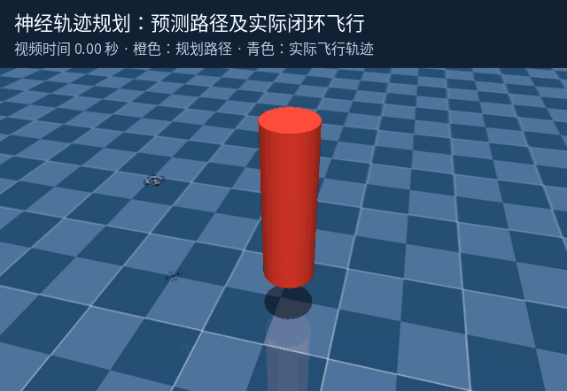

| 验证环节 | 实际结果 |
|---|---|
| 独立预测测试 | 256 个场景，路径点相对监督标签 RMSE 0.01019 m |
| 规划几何检查 | 每条路径采样 601 点，最小中心线至圆柱表面距离 0.13361 m，采样点进入圆柱 0 条 |
| 动力学闭环场景 | 独立测试第 0 场景；500 Hz 物理、100 Hz 控制；执行 8 秒并稳定 2 秒 |
| 三维跟踪 RMSE | 0.083661 m，参考与状态按控制步结束时刻对齐 |
| 末目标误差 | 0.08113 m |
| 执行接触检查 | 1,000 个控制步中接触阳性 0 次 |

预测测试属于几何采样，实际动力学飞行对应其中一个预定场景。场景限定为已知单静态圆柱；中心线距离未扣除机身半径，不能作为连续碰撞安全保证。

## 六、跨仿真器的独立闭环对照

针对 Sim2Sim 闭环验证要求，在 Crazyflow 与独立 MuJoCo 刚体动力学中分别部署同一冻结高度控制器。两个引擎各自根据实际位置和速度计算反馈，不共享仿真状态；对齐质量、重力、电机响应、推力与阻力参数，以 500 Hz 物理频率、50 Hz 控制频率执行 8 秒垂直轨迹。

**图 11　两个动力学引擎的独立闭环与记录轨迹。** 401 个采样点的跨引擎高度差 RMSE 为 **0.000632 m**，最大差为 **0.000930 m**；两引擎相对目标高度的 RMSE 分别为 0.077688 m、0.077078 m。

该验证覆盖同参数、无接触和外部扰动的单机垂直运动，控制器为固定位置—速度反馈。结果对应上述对照条件，不代表任意三维场景或神经策略的跨引擎迁移性能。

## 七、虚实迁移链路与真实飞行效果

针对 Sim2Real 闭环验证及高保真迁移要求，技术链路包括机型与执行器参数对齐、仿真训练及策略冻结、状态和坐标系映射、控制接口适配、真实定位反馈与同轨迹误差评估。以下采用 Crazyflow 原作者的公开实飞片段，直接展示仿真相关算法在真实无人机上的飞行效果。

### 实物八字轨迹跟踪

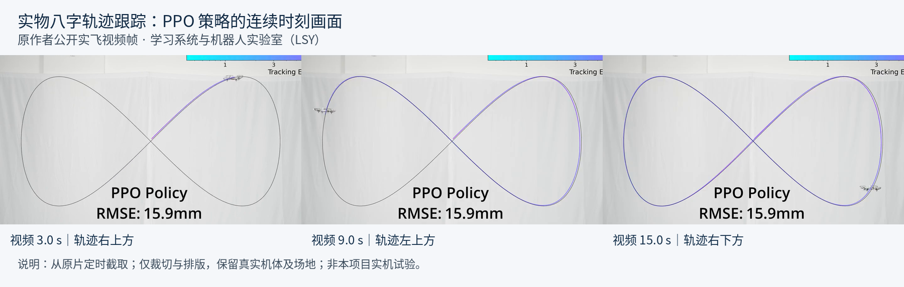

**图 12　真实场地中的实物轨迹跟踪。** 取自同一公开视频的 3、9、15 秒：同一机体分别位于八字轨迹右上、左上及右下位置。真实机体、场地和原片轨迹叠加均保留；原片“15.9 mm”为作者标注的 PPO 实机轨迹跟踪误差，归属于该公开试验。

<video controls preload="metadata" width="100%" poster="peibiao_assets/real_flight/tracking_sequence.png" src="peibiao_assets/real_flight/trajectory_tracking.mp4"></video>

实际飞行片段：实物无人机沿八字轨迹持续运动

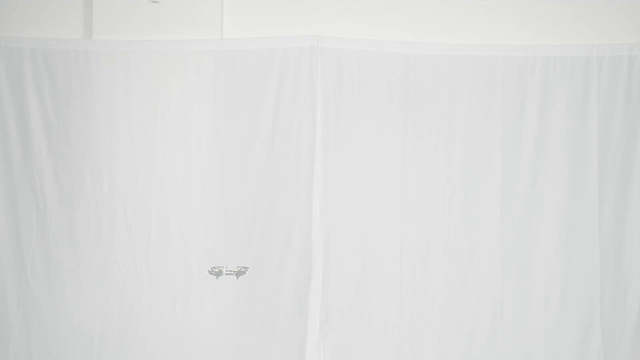

### 实物离手恢复与空中稳定

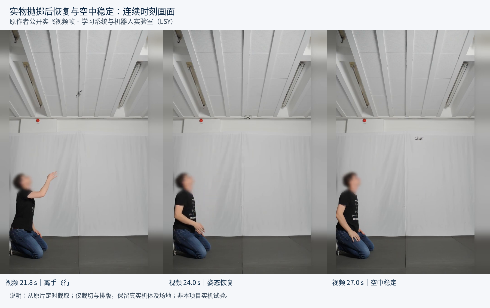

**图 13　真实无人机离手后的闭环恢复过程。** 取自原作者公开视频的 21.8、24、27 秒，画面保留操作人员、真实场地及机体位移，可直接辨识离手、恢复和空中稳定过程。

<video controls preload="metadata" width="100%" poster="peibiao_assets/real_flight/deployment_sequence.png" src="peibiao_assets/real_flight/deployment_excerpt.mp4"></video>

实际飞行片段：离手后的恢复与稳定

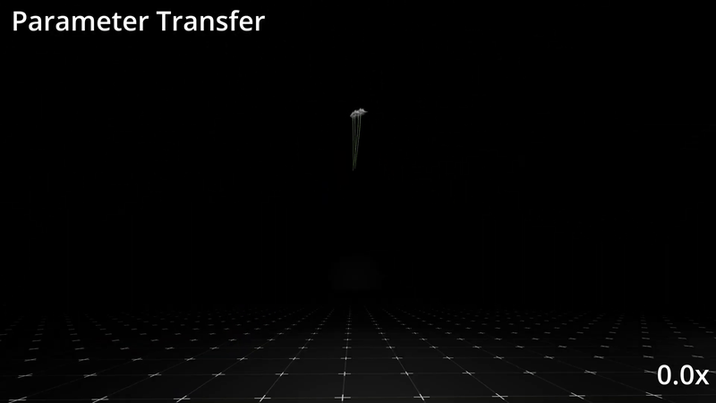

**实飞资料归属：学习系统与机器人实验室（LSY）公开发布。** 上述画面为真实飞行视频帧及片段，已保存为本地素材，来源、时间戳和加工说明随交付文件保留；本项目新增试验为仿真记录，不将公开实飞归属于本项目。目标硬件的最终迁移验收仍需对应机型的部署记录与独立实飞测量。

## 验证条件与证据交付

新增仿真采用 Python 3.12、JAX 0.11.1、MuJoCo/MJX 3.10.0 和 PyTorch 2.8.0 CPU 后端；图表直接使用保存的训练历史、模型权重与原始轨迹计算，视频画面来自实际仿真或已标注来源的公开实飞。静态连续帧供文档审阅与打印，内嵌视频及动画供动态核验。

| 证据内容 | 随附文件位置 |
|---|---|
| 动力学输入、状态及模型参数记录 | `peibiao_assets/dynamics_*` |
| 地效与下洗对照程序及气动记录 | `peibiao_assets/aerodynamics/` |
| 多机规划程序、原始轨迹及指标 | `peibiao_assets/swarm_*` |
| 强化学习训练程序、模型及日志 | `usage_assets/train_gymnasium.py`、`peibiao_assets/rl_cpu_*` |
| 神经规划训练程序、权重及轨迹 | `peibiao_assets/neural_planner_*` |
| 独立引擎闭环程序与采样数据 | `peibiao_assets/sim2sim_*` |
| 中文图表及其原始数据追溯 | `peibiao_assets/charts/` |
| 仿真连续帧、动态演示及重放记录 | `peibiao_assets/presentation/` |
| 实飞片段、原片与来源说明 | `peibiao_assets/real_flight/` |

相关 CPU 测试 33 项通过；动力学、规划及独立引擎试验已复跑，训练策略已重新加载并独立评估。采样指标、训练预算、测试规模和场景范围随各节列示，作为本材料的验证依据。
