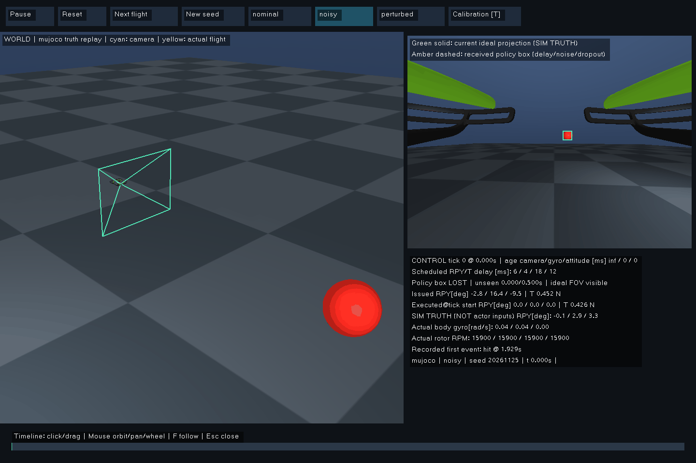

# Dani：cf21B_500 气球接触，纯 BPTT

按下面四步完成 Docker 配置、实物辨识、训练和评测。策略使用 bbox、姿态、机体角速度和历史信息，yaw 参与控制，不读取位置或线速度。训练通过 Crazyflow 的可微物理做 BPTT，使用官方 `cf21B_500` 完整动力学和姿态控制器。

在项目根目录运行 `./dani`；无需激活 Python 环境或设置终端变量。先跑默认仿真时，只需 `setup → train → evaluate → play`；所有结果保存到 `outputs/`。

## 先看配置放在哪里

| 要调整什么 | 编辑文件 | 默认内容 |
| --- | --- | --- |
| 训练次数、并行数、学习率、随机种子 | [config/training.yaml](config/training.yaml) 的 `training` | 1500 次；GPU 1024 / CPU 32 个并行世界 |
| 轨迹时长、历史长度、气球尺寸/距离、控制与终止界限 | 同文件的 `task` | 50 Hz 策略、500 Hz 物理/控制器，yaw 不锁定 |
| 接触、视野、安全、速度与动作平滑等优化权重 | 同文件的 `objective` | 可微目标；实际成功仍以接触判定 |
| 质量/推力/电机响应随机化，bbox/IMU 噪声、丢帧和延迟 | 同文件的 `noise` | 默认开启，属于训练假设，可按实测调整 |
| 质量、惯量、力臂、推力/反扭矩曲线、旋翼动态和阻力 | [config/vehicle.toml](config/vehicle.toml) | 官方 `cf21B_500` 完整物理参数 |
| 姿态控制器增益、混控、分配端推力映射 | [config/controller.toml](config/controller.toml) | 官方姿态与力矩分配参数 |
| 图像分辨率、水平视场、相机内参与安装外参 | [config/camera.json](config/camera.json) | 640×480、水平 120°、向前偏置 3 cm |
| 无人机外观、网格与基础场景 | [assets/](assets/) | 官方机体 XML、网格与场景；相机标定仍由 `camera.json` 控制 |

通常只修改上面四份配置。底层各模型的默认表也已移到 `config/dynamics/`、`config/control/`；`crazyflow/` 保留 BPTT、仿真、控制和辨识逻辑。详细字段、单位和坐标轴见 [config/README.md](config/README.md)。

两份技术资料已放到本地：[Crazyflie/BPTT 与辨识说明](docs/Crazyflie与Crazyflow_BPTT关键问题与辨识方案.pdf)、[视觉可微仿真与实机控制说明](docs/苏黎世穿缝_可微分仿真与实机控制.pdf)。具体操作和当前默认值以本项目手册、配置为准。

## 1. 一键配置 Docker

```bash
./dani setup
```

宿主先装好 Docker。脚本构建统一镜像，在容器内实际执行 JAX 计算，**优先 GPU，不可用时自动使用 CPU**。GPU 需要宿主已有 NVIDIA 驱动与 Container Toolkit；Python、JAX、CUDA 用户态库和 MuJoCo 都在镜像中。[配置脚本](scripts/setup.sh)和[设备检测](scripts/common.sh)中有说明。

后续命令会自动选择设备；镜像不存在时自动构建。修改代码或依赖后重新运行 `./dani setup`。修改四份用户配置后可直接训练，启动器会读取当前文件，无需重新构建镜像。

## 2. 实物测量与辨识（先跑仿真可跳过）

直接使用默认飞机时，进入第 3 步。增加 RGB 模组、更换电机/桨后，先建立测量模板：

```bash
./dani identify init
```

打开 `outputs/measurements/`，按[测量与日志采集手册](docs/identification.md)测量最终装机总重、质心、力臂与惯量，整理独立的训练和验证日志。核实真实测量后，才设置 `confirmed_measurements=true`。

| 已准备的数据 | 一键入口 | 结果与覆盖范围 |
| --- | --- | --- |
| 机械 RPM、质心 IMU、已测质量/J | `./dani identify flight --negligible-drag` | `physical.toml`：拟合公共推力、yaw 反扭矩曲线，合并测量值和明确标记的继承项 |
| 上述日志，加目标/实际 RPM 瞬态 | `./dani identify rotor --negligible-drag` | 重新联合导出 `physical.toml`，补充旋翼升降速系数 |
| **可选**的推力/扭矩台数据 | `./dani identify static` | `static-check.toml`：单独交叉检查，不覆盖飞行拟合 |
| 带参考位置/姿态的闭环飞行日志 | [辨识手册中的阻力步骤](docs/identification.md) | 官方简化闭环模型的推力延迟与阻力；不能直接替换第一性原理表 |

**没有推力/扭矩台也可走飞行日志路线**，但仍需可信机械 RPM、IMU、质量与惯量；只有姿态和角速度不足以辨识全部参数。`--negligible-drag` 表示确认所选片段中阻力与其它外力可忽略。离线辨识可使用参考位置/速度，它们不会成为策略输入。

没有硬件时，先用明确标记的[合成示例日志](examples/identification/README.md)检查流程：

```bash
./dani identify check
./dani identify drag-check
```

辨识结果与用户配置的关系：

- `physical.toml` 可作为本次训练的机体参数覆盖，命令见下一步；JSON 报告说明哪些量经过测量、拟合或继承。
- 姿态增益、分配端映射与真实固件的 N→驱动映射需另行核对；物理辨识不会自动调整 `controller.toml`。
- 闭环阻力示例输出的是另一种模型，不能直接作为 `--model-params`。完整第一性原理阻力仍需按手册核对力、速度与坐标约定。

示例保留独立的 train/valid 两段日志；官方底层拟合允许不提供验证日志，这里保留验证用于检查拟合之外的飞行。示例日志是合成数据，不是改装实机参数。

## 3. 一键训练 BPTT

```bash
./dani train
```

默认读取 `config/` 下的训练 YAML、机体 TOML、控制器 TOML 和相机 JSON，自动选择设备与对应并行数，并创建新结果目录。训练前不需要运行其它项目。

调整训练时，先编辑 `training.yaml` 对应部分：`training` 管优化器，`task` 管任务与控制界限，`objective` 管可微目标，`noise` 管扰动。不确定时保留默认；质量和推力曲线等真实机体数值在 `vehicle.toml` 中设置。

链路等待、丢包、gyro 乘性噪声与相关扰动在 `noise.hardware` 配置；gyro 现在默认采用 CrazyRL 的每轴 `N(1,0.1²)` 乘性随机误差，并保留加性白噪声和固定零偏，其它新增未知扰动幅度仍为 0。含义见[配置说明](config/README.md#硬件链路与额外扰动)；旧策略仍使用冻结配置，修改 YAML 后需重新训练。

使用已测量验证的物理辨识结果：

```bash
./dani train --model-params outputs/measurements/physical.toml
```

核对并更新实机控制器后，可另加 `--controller-params outputs/measurements/controller.toml`。一次性覆盖训练次数/并行数可用 `--iterations`、`--batch-size`；完整选项见 `./dani train --help`。

相机按 OV5647 广角的假定配置使用水平 **120°**。直接编辑 `camera.json` 的分辨率、内参与外参；真实广角图像需先去畸变，并在校正图上 track bbox，再填对应 K。修改标定后重新训练。

气球按标称直径 30 cm 的 **0.1–2 倍**对数均匀采样，即直径 **3–60 cm**；20% 静止，其余以 **0–1.5 m/s、三维任意方向匀速直线**移动。在 `training.yaml` 的 `task.target_*` 修改这些范围；真实尺寸和目标速度只用于仿真、损失与评测，不进入策略。

每次训练会保存 `config/` 副本和 `policy.npz`。策略文件冻结有效的物理、控制器和相机参数，后续修改本地配置不会改变已有策略。`./dani train --smoke` 只做小规模流程检查，不替换最近一次正式训练。

训练标量保存在 `training.jsonl`，结束后自动生成 `training.png`（损失、验证损失、梯度和耗时），无需 TensorBoard 服务。已有一份验证有效的[示例权重与曲线](examples/balloon/README.md)，与辨识示例并列保存在 `examples/balloon/`。

显存参考：RTX 4070 Ti SUPER 16GB，当前默认配置、150×10 步展开、关闭预分配，每档 3 次完整 BPTT 更新，**1024 / 4096 / 8192 / 16384** 个环境的进程采样峰值约 **1.0 / 3.0 / 5.5 / 10.9 GiB**；另留桌面等进程的余量。修改 YAML 的 `batch_size.gpu` 调整并行数，[实测记录](examples/balloon/gpu-capacity.json)不代表其它显卡的容量上限。

默认保留 **1024** 环境：此前静态任务同种子、同 1500 次更新的单次对照中，8192 环境耗时多约 28%，接触数未增加；该结论尚未针对新的移动/宽尺寸任务重测。

## 4. 一键 MuJoCo 评测与 GUI

想先看已训练模型在训练噪声下的表现，直接打开示例 GUI：

```bash
./dani play --example --suite noisy
```

省略 `--suite` 时默认打开无额外噪声的 `nominal`；`noisy` 使用训练噪声，`perturbed` 进一步加强动力学扰动与初态范围，窗口内可按 `1/2/3` 切换。

也可先用 `./dani evaluate --example` 重新评测示例。新版移动/宽尺寸策略在 MuJoCo 的 nominal / noisy / perturbed 三组各 256 次中，实际接触 **253、249、245** 次；剩余失败均在直径 3–10 cm 子集，详见[示例说明](examples/balloon/README.md)。

```bash
./dani evaluate
```

自动读取最近一次成功训练，默认用原生 MuJoCo 实际推进三组飞行：无噪声、训练噪声、更强扰动。以无人机与气球实际接触判定成功，保存 `metrics.json`、轨迹和视频。

训练时由 Crazyflow 几何生成理想 bbox；测试时由 MuJoCo 当前位姿生成同样的理想 bbox，再按场景叠加噪声、裁剪、丢帧和延迟。无需先训练图像检测器。两端共用策略中冻结的相机标定和观测处理，MuJoCo 同时提供对应的相机画面。

MuJoCo 刚体积分运行在 CPU，策略、官方控制器和旋翼力模型使用自动选定的 JAX 设备；BPTT 训练的可微物理与优化则全部使用所选 JAX 设备，支持 GPU 并行。GUI 首次启动需编译并生成三组完整飞行，随后播放；需要对照训练物理时，可用 `./dani evaluate --plant crazyflow`。

GPU 桌面 GUI 使用硬件 OpenGL，评测视频使用 EGL 离屏渲染；启动时输出实际设备。JAX 编译缓存自动保存在 `outputs/.cache/`，供后续启动和随机重置复用。

打开最近一次评测：

```bash
./dani play
```

窗口回放策略闭环仿真得到的轨迹，每次随机重置都重新运行仿真。Linux/X11 中默认跟随飞机与气球；鼠标左拖旋转、右拖平移进入自由视角、滚轮缩放，`F` 恢复跟随。绿色实线是理想 bbox，琥珀虚线是策略收到的框。`R` / **Random reset** 在后台重新采样气球位置、尺寸、速度、飞机初态和噪声，完成后开始新轨迹；`Backspace` / **Replay** 重播同一条轨迹。`Space` 暂停，左右键逐帧，`1/2/3` 切换场景（`2` 包含 gyro 噪声），`T` 查看相机标定。

左下 XY map 按米等比例显示飞机和气球的已飞轨迹，目标虚线表示匀速直线路径，箭头表示 **1 秒的水平位移**；同时列出 `vx/vy/vz`、总速度和双方高度。地图使用仿真真值辅助观察，不进入策略输入；纯竖直移动会单独标明。



预训练策略的 MuJoCo GUI 实录，依次展示 `noisy`、`perturbed` 各两个回合，均使用带噪声的实收观测，展示到各自首次结局；机体标称动力学使用官方 `cf21B_500` 默认参数，实机改装后按第 2 步重新辨识。

没有显示设备时，使用 Xvfb 软件窗口检查 GUI 并保存截图：

```bash
./dani play --headless
```

各命令支持 `--help`，需要强制 CPU 时加 `--device cpu`。重复训练或评测会创建新目录；失败时保留已有成功结果，不覆盖最近成功指针。

| 命令 | 常用参数（默认值） | 示例 |
| --- | --- | --- |
| `setup` | `--device auto/cpu/gpu`（auto） | `./dani setup --device cpu` |
| `identify` | `--directory`（outputs/measurements）；其它量见辨识手册 | `./dani identify init --directory outputs/my-drone` |
| `train` | `--batch-size`、`--iterations`、`--lr`（读取 YAML）；`--smoke` | `./dani train --batch-size 4096 --iterations 1500` |
| `evaluate` | `--example` 或 `--checkpoint`；`--episodes`（256）、`--no-video`、`--plant`（mujoco） | `./dani evaluate --example --episodes 32 --no-video` |
| `play` | `--example`、`--checkpoint` 或 `--evaluation`；`--seed`、`--headless` | `./dani play --example --seed 7` |
| `play` 录制 | `--record`、`--fps`（20）、`--suite`（nominal）、`--episode`（0） | `./dani play --headless --record outputs/gui.gif` |
