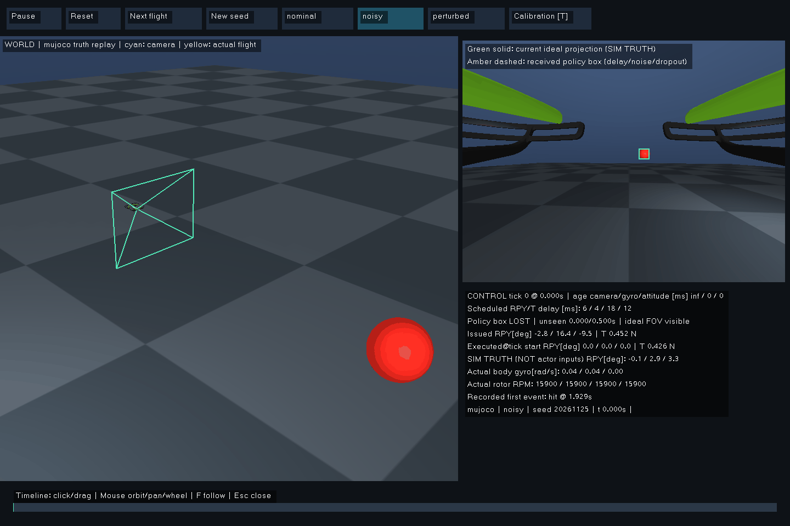

# BPTT 撞气球示例

本目录保存实际完成的 `cf21B_500` 纯 BPTT 策略、原始标量日志、曲线及原生 MuJoCo 评测记录。策略只接收 bbox 历史、姿态、机体角速度和先前指令，不接收位置或线速度。

训练使用 seed 42、GPU batch 1024，完整完成 **1500** 次更新；`policy.npz` 是验证最优的第 **1425** 次参数。初始验证损失 **12.44566**，最优 **1.23349**，第1500次 **1.27737**。61条 [JSONL](training.jsonl) 与 [曲线](training.png)记录损失、梯度及耗时；损失不等于接触率。

相机为640×480、水平120°、前置0.03m；策略50Hz，物理/姿态控制/IMU 500Hz，每条轨迹150拍、3s。相机逐包延迟0–40ms，RPY三轴和总推力指令各自延迟0–20ms，采用因果到达队列；这些边界沿用项目原有先验。**新增未知噪声、漂移、乘性误差、物理失配及阵风幅度均为0，需测量后填写。** 完整有效值冻结在checkpoint和[评测摘要](evaluation-summary.json)中。

固定评测seed `20261125`，三场景各256次，所有失败均保留在分母中：

| 场景 | 首次接触 | 接触率 | Wilson 95%区间 | 其余结果 |
| --- | --- | --- | --- | --- |
| nominal | 256 / 256 | 100.00% | 98.52%–100.00% | 无 |
| noisy | 256 / 256 | 100.00% | 98.52%–100.00% | 无 |
| perturbed | 242 / 256 | 94.53% | 91.03%–96.71% | 失视14 |

接触采用每个积分子步内扫掠球体首次相交；超过2.5m/s仍算接触，只另作速度诊断。MuJoCo的`mj_step`实际积分刚体，但与训练共享官方控制器和旋翼力/力矩模型。这是仿真结果，尚未验证实机或真实视觉检测器。



[GUI记录](gui.json)对应同一checkpoint、seed及`noisy`的episode0，完整显示到首次命中并停留1秒；绿色实框为当前理想投影，琥珀色虚框为策略实际收到的延迟/噪声框。动作和实收观测按策略拍标记，仿真真值单独注明。

[容量短测](gpu-capacity.json)：NVIDIA GeForce RTX 4070 Ti SUPER，完整150×10展开、关闭预分配，每档独立进程只做3次BPTT更新；以下为进程采样峰值，另需为桌面等进程留余量：

| 并行环境数 | 进程采样峰值 | 结果 |
| --- | --- | --- |
| 1024 | 1.04 GiB | 完成3次更新 |
| 4096 | 3.04 GiB | 完成3次更新 |
| 8192 | 5.54 GiB | 完成3次更新 |
| 16384 | 10.79 GiB | 完成3次更新 |

容量短测不说明收敛质量，也不是其它显卡的上限。[来源记录](provenance.json)保存原始输入及本目录产物的SHA256；策略原字节保留，标称12项物理和17项控制字段与官方表经float32转换后一致。

在项目根目录执行：

```bash
./dani setup
./dani evaluate --example
./dani play
```

直接查看示例策略可用 `./dani play --example`；无桌面时用 `./dani play --example --headless`。保存完整GIF可运行 `./dani play --example --headless --suite noisy --record outputs/example-flight.gif`。入口复制策略到唯一的`outputs/example-policy-*`，新评测、轨迹和视频写入`outputs/`。
