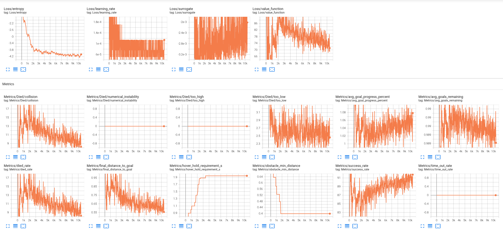
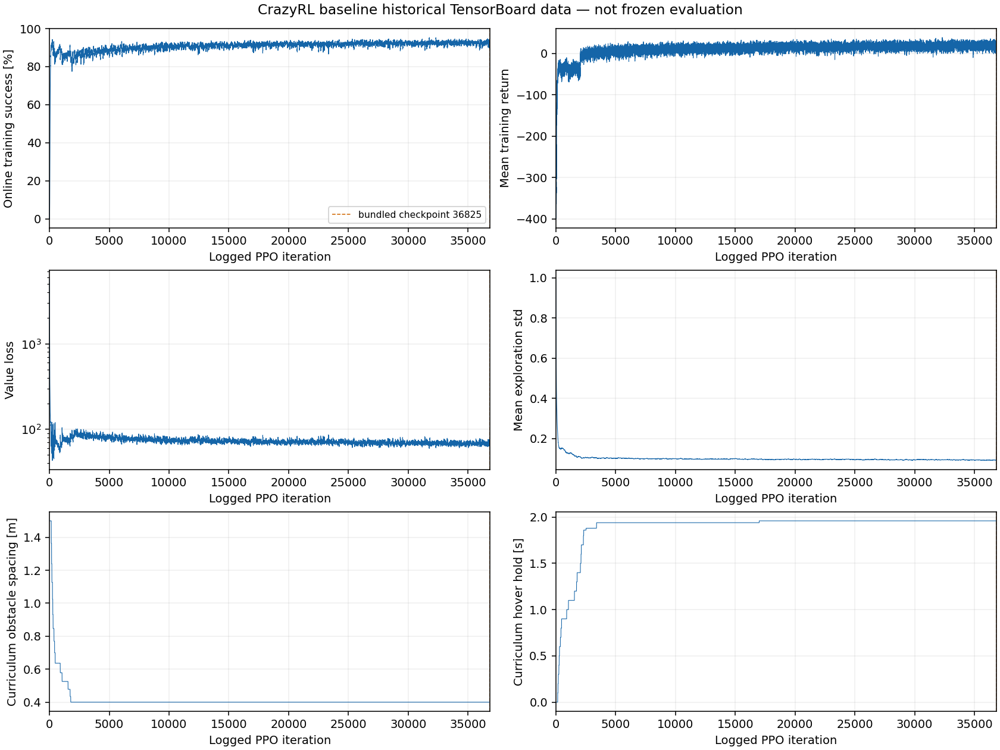
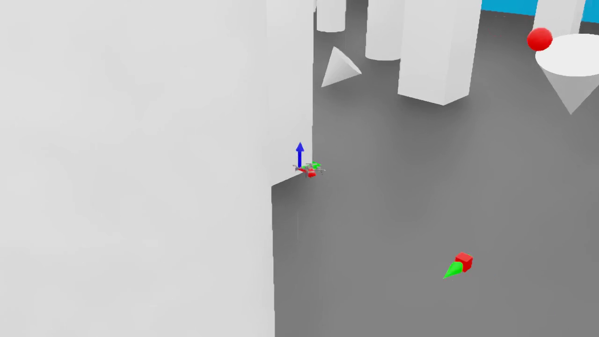

# 官方 CrazyRL baseline

`model_36825.pt` 来自上游 CrazyRL 的 `assets/replementation/rl/model_36825.pt`，导入时的仓库修订为 `9333442c18fa15799adac7e02988a978aeaf97b9`。本项目保留原文件，SHA256 为 `7c3ecc53bf468989789b1deee0c3efd6856438604aa5b0f19e35693527d15cc3`，没有重新训练 baseline。该修订标识来源快照；资产未记录原训练启动时的代码 commit。

历史原始归档共 **10 个文件、91,684,204 bytes**，逐文件大小、哈希及归档位置见 [manifest.json](evidence/manifest.json)。Git 保存检查点、可读配置、截图和精简证据；原始事件、视频、pickle、ONNX 与重复导出不随 Git 分发，已有归档位于忽略目录 `outputs/sim2sim/baseline-reference/`。

| 内容 | 本地位置 |
| --- | --- |
| 原始 RSL 完整检查点 | [`model_36825.pt`](model_36825.pt) |
| 配置 | [`agent.yaml`](agent.yaml)、[`env.yaml`](env.yaml)；env 仅将 USD 位置改为本仓库资产 |
| 原始训练面板截图 | [`evidence/rl.png`](evidence/rl.png) |
| 完整日志曲线与 35 个标签摘要 | [`training-curves.png`](evidence/training-curves.png)、[`tensorboard.json`](evidence/tensorboard.json)、[`tensorboard-scalars.csv`](evidence/tensorboard-scalars.csv) |
| 检查点、训练配置与媒体核验 | [`checkpoint.json`](evidence/checkpoint.json)、[`training.json`](evidence/training.json)、[`media.json`](evidence/media.json) |
| 原始事件 | `outputs/sim2sim/tensorboard/events.out.tfevents.1768936229.dcj.32.0`；归档内通过相对链接复用 |
| 其余原始文件 | `outputs/sim2sim/baseline-reference/`，保持来源目录结构；全部逐字节核对 |

## 它如何训练

这是 **Isaac Lab / RSL-RL 的 PyTorch PPO**。保存配置为 `static_goals`、26,000 环境、每环境 120 步、5 epochs、200 minibatches、ELU `[256,256,128,64]`、经验归一化及自适应学习率，初始配置值 `5e-4`。actor 输入 344 维、输出原始四维动作，critic 输入 434 维；完整值见 [training.json](evidence/training.json)。

**TensorBoard 是日志展示工具，不是 TensorFlow 训练。** 上游训练入口导入 `torch` 并调用 RSL `OnPolicyRunner.learn`，配置为 `logger: tensorboard`；原始 `.pt` 包含 Torch 模型、Adam 和归一化状态，原 ONNX 记录的 producer 也是 PyTorch。源码相对路径与摘要见 [training.json](evidence/training.json)。

检查点内部 `iter=36825`。事件包含 35 个标量标签、1,287,560 个点，迭代轴为 **0–36845**；`/time` 标签的 19–732135 是累计记录秒数轴。事件时间覆盖 2026-01-20 至 01-29（UTC）。步骤 36825 的在线训练成功指标为约 **92.77%**，日志末尾约 **93.47%**；它们不是离线评测成功率，日志末尾也不是该检查点的保存时刻。

`max_iterations=100000` 是配置上限。保存的 `resume: false` 同时伴随旧 `load_run/load_checkpoint` 选择字段；这些信息不足以证明全部迭代均从随机网络开始，不能据此推算完整训练预算。原始 TorchScript 导出的 actor 权重与本检查点逐位相同，128 个 CPU 探针的原始动作差为 0，记录见 [checkpoint.json](evidence/checkpoint.json)。

原始截图保留其当时约 10k 的显示范围：



下图由全部历史事件离线绘制，未平滑；虚线标出检查点 36825：



原视频中间帧如下；这是历史播放记录，不能替代新运行或独立评测：



## 在本项目加载

以下命令均在项目根目录运行。先构建独立 Isaac 镜像：

```bash
./crazyrl sim2sim build
```

明确加载官方权重进行 GUI 播放：

```bash
./crazyrl sim2sim play --policy models/baseline/model_36825.pt --gui --num-envs 8 --max-steps 450
```

运行一组离线评测：

```bash
./crazyrl sim2sim evaluate --policy models/baseline/model_36825.pt --num-envs 32 --seed 42 --output outputs/sim2sim/baseline-seed42
```

比较自己训练的 PT 时，`compare` 自动加载这份官方 baseline，并核对初始场景一致：

```bash
./crazyrl sim2sim compare --policy outputs/my-tof/policy.pt --num-envs 32 --seed 42 --output outputs/sim2sim/my-tof-seed42
```

历史离线验收为 **1265/1280**，协议与逐回合数据见 [`reports/baseline-reference/`](../../reports/baseline-reference/)。本项目另一次同场景配对比较中，baseline 为 **155/160**、Crazyflow 策略为 **132/160**，见 [`reports/sim2sim/final/`](../../reports/sim2sim/final/)。两次预算不同，均与上面的在线训练指标分开记录。

## TensorBoard 与原始归档迁移

**新克隆包含模型、配置、截图和摘要，不包含原始事件、视频等忽略文件**。从已有完整归档迁移时，在原工作目录打包：

```bash
tar -czf outputs/baseline-reference.tar.gz outputs/sim2sim/baseline-reference outputs/sim2sim/tensorboard
```

把压缩包放到新工作目录的 `outputs/` 后，从项目根目录恢复：

```bash
tar -xzf outputs/baseline-reference.tar.gz
```

事件恢复后启动 TensorBoard，浏览器访问 `http://127.0.0.1:6006`：

```bash
./crazyrl sim2sim tensorboard --port 6006
```
