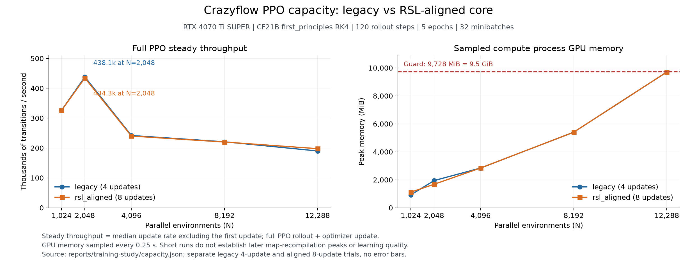
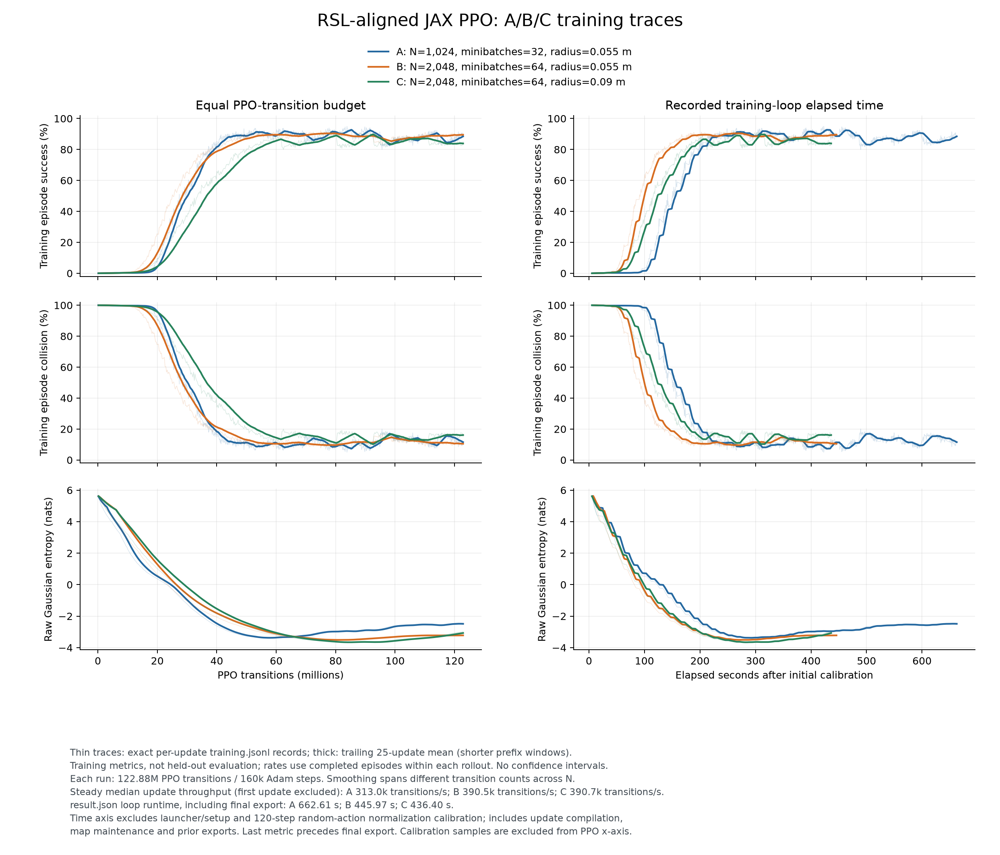
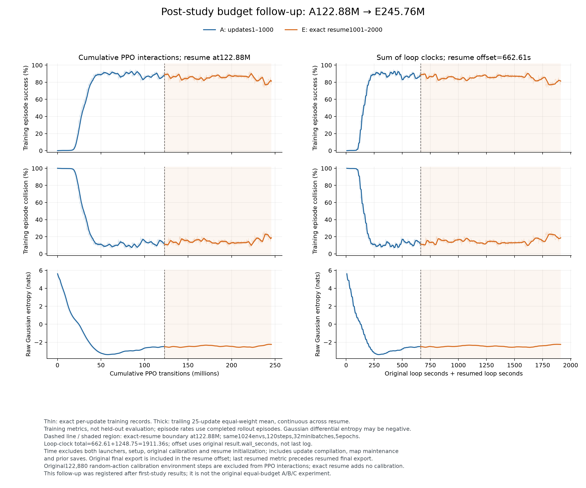

# 训练配置、吞吐与迁移研究

本次在 RTX 4070 Ti SUPER（16,376 MiB）上核对 CrazyRL 的源实现、现有模型及训练日志，并进行新训练对照。Isaac 的任务、机体、噪声、奖励和评测逻辑保持冻结。历史模型与结果保留在[原报告](../crazyflow/README.md)，本目录记录新的审计和实验。

## 已确认的差异

保留的历史策略开启观测噪声和 domain randomization。与固定 CrazyRL 源码对应的内容包括：乘性传感器噪声、前向深度无效点及共享失效概率、目标测量噪声、OU 风、控制器质量/惯量扰动、推力初始效率与衰减、速度范围和地图课程。具体公式、相关性、源码 SHA 与运行时课程见 [environment-parity.json](environment-parity.json)。

这些分布对齐不代表动力学和接触几何相同：

| 项目 | Crazyflow 训练 | Isaac 目标环境 |
| --- | --- | --- |
| 名义机体质量 | 官方 CF21B 0.0434 kg | USD 0.049 kg |
| 执行器 | RPM、电机动态、混控、阻力 | 直接力/力矩与 PhysX |
| 接触近似 | 半径 0.055 m 的球 | 实际碰撞盒 0.15×0.15×0.045 m |

碰撞盒尺寸来自 USD 中唯一启用的 Cube collider（0.1×0.1×0.03 m）及任务 1.5 倍缩放，未从外观网格猜测。0.055 m 球可能低估横向碰撞；0.09 m 是本次测试的保守训练参数，仍不等同于盒子，水平对角半径为约 0.1061 m。没有增加无依据的噪声，也没有修改评测碰撞体。

## PPO 对齐到哪里

此前保留模型使用 `legacy`，不能称为与 RSL 完全相同。现在增加显式 `rsl_aligned`，保留 JAX/Flax/Optax 的 functional/JIT/scan 训练方式：

| 内容 | 历史实现 | 新实现 |
| --- | --- | --- |
| Advantage | 每个 minibatch 单独归一化 | 完整 rollout 归一化，sample std |
| KL / 学习率 | 采样动作近似 KL，更新后调 LR，上限 0.001 | 参考解析 Gaussian KL，当前更新前调 LR，上限 0.01 |
| Adam epsilon | 1e-5 | 1e-8 |
| 经验归一化 | 持续更新 | 达到约 1 亿样本后冻结 |

网络、horizon=120、5 epochs、γ=0.99、λ=0.95、clip=0.2、entropy=0.005、value coefficient=1 和梯度范数限制保持对应。仍明确保留的差异是：JAX 的归一化在每轮 rollout 内冻结，RSL 每步更新；JAX 优化 logstd，RSL 优化 std；初始化和 shuffle 不同；minibatch 数按硬件调整。JAX 使用正确的重置前 next-state timeout bootstrap，没有复制参考实现使用当前 value 的近似。详细说明见 [ppo-parity.json](ppo-parity.json)。

旧配置缺失 `ppo_variant` 时仍使用 `legacy`；完整 resume 检查禁止静默混用两种优化语义。现有已发布权重没有因代码对齐而自动改变。

## 并行数实测

下表为新核心、120 步、5 epochs、32 minibatches，每档实际运行 8 次完整 PPO 更新；稳态取除首次外的中位数。原核心 4 次更新对照也保存在 [capacity.json](capacity.json)。

| 环境数 | 稳态秒/更新 | samples/s | 计算进程采样峰值 MiB |
| ---: | ---: | ---: | ---: |
| 1,024 | 0.377 | 326,199 | 1,114 |
| 2,048 | 0.566 | 434,288 | 1,678 |
| 4,096 | 2.048 | 240,012 | 2,842 |
| 8,192 | 4.468 | 220,032 | 5,402 |
| 12,288 | 7.454 | 197,810 | 9,704 |

12,288 能运行，但吞吐只有 2,048 的约 46%，并已接近 9,728 MiB（9.5 GiB）保护线。更大的 14,336 在此前测量中触发保护。短测不能保证后续更密地图与重新编译始终容纳，因此不把最大环境数当作推荐值。



复测本机完整 PPO 容量：

```bash
./crazyrl capacity --config config/training.yaml --envs 1024 2048 4096 8192 12288 --iterations 8 --output outputs/my-capacity
```

每次更新的数据量为 `环境数×120`，梯度更新数为 `minibatches×5`。环境数增加但 minibatch 数不变，会增大单个 minibatch、减少同样交互预算内的梯度步数。地图课程还按 reset-batch 推进；相同样本数不保证相同地图数量，不能把旧两阶段训练的差异单独归因于并行数。

## 新训练对照设计

三组均从随机网络开始，seed=42，使用修正后的几何、相同状态/动作/奖励和噪声分布，不借用 baseline 参数。每组 **122,880,000 transitions、160,000 次 Adam 更新、每 minibatch 3,840 个样本**：

| 实验 | 环境 | minibatches | PPO 更新 | 训练碰撞半径 |
| --- | ---: | ---: | ---: | ---: |
| A | 1,024 | 32 | 1,000 | 0.055 m |
| B | 2,048 | 64 | 500 | 0.055 m |
| C | 2,048 | 64 | 500 | 0.09 m |

A/B 用于比较环境数与 rollout 分组，B/C 单独比较碰撞裕度。开始 PPO 前还执行一次无梯度随机动作 rollout，以校准归一化：A 额外 122,880 次环境步，B/C 各额外 245,760 次；它们不计入上述 PPO 交互数。课程地图数量也随训练记录；这是单训练种子的探索，不足以证明普遍最优超参数。配置快照见 [configs/](configs/)，预先确定的评测流程见 [plan.json](plan.json)。

复现 A：

```bash
./crazyrl train --device gpu --config reports/training-study/configs/A-1024-control.yaml --num-envs 1024 --iterations 1000 --output outputs/study-A
```

复现 B：

```bash
./crazyrl train --device gpu --config reports/training-study/configs/B-2048-control.yaml --num-envs 2048 --iterations 500 --output outputs/study-B
```

复现 C：

```bash
./crazyrl train --device gpu --config reports/training-study/configs/C-2048-clearance.yaml --num-envs 2048 --iterations 500 --output outputs/study-C
```

## 完整训练实测

三组均正常完成。以下“总耗时”从调用启动器开始，包含 GPU 检查、初始校准与绘图；平均吞吐采用训练循环墙钟，包含模型保存、地图维护和重新编译。它不同于前面短容量测试的稳态数字。计时未隔离全部主机与桌面负载，A 期间还运行了 CPU 测试；没有并行的其他 CUDA 训练，不能把墙钟差异全部归因于环境数。

| 实验 | 总耗时 | 训练循环平均 samples/s | 计算进程采样峰值 MiB | 地图更换次数 | 最终间距 / hold |
| --- | ---: | ---: | ---: | ---: | --- |
| A：1024 / 32 | 674.32 s（11.24 min） | 185,448 | 1,394 | 38 | 0.770 m / 0.7 s |
| B：2048 / 64 | 457.45 s（7.62 min） | 275,533 | 1,942 | 19 | 1.025 m / 0.4 s |
| C：2048 / 64 / 0.09 m | 445.78 s（7.43 min） | 281,576 | 1,548 | 19 | 1.025 m / 0.4 s |

B 比 A 的完整调用快约 32%，循环平均吞吐高约 49%。地图更换次数也减半，所以这不能解释为只改变 GPU 并行度的算法实验。B/C 的最后 25 次更新、按结束回合数加权的在线成功率约 89.51% / 83.88%；较大碰撞球使训练判定更保守，这些在线数字不用于跨仿真器选模。逐项计时、配置/模型/日志哈希与校准预算见 [training.json](training.json)。



## 验证与选模

统一的 Crazyflow 验证使用 0.09 m 半径、地图种子 42、初态种子 9001、256 个首回合。Isaac 开发验证使用冻结任务、地图种子 42、每个策略 32 个首回合，并核对初始场景哈希相同。预定规则是：Isaac 成功率严格高于旧模型，且共同 Crazyflow 成功率下降不超过 2 个百分点，才有资格入选；合格候选依次按 Isaac 成功率、Crazyflow 平均 return、A/B/C 顺序排序，与旧模型同分则保留旧模型。

| 策略 | 共同 Crazyflow 成功 | Isaac 开发成功 | 候选资格 |
| --- | ---: | ---: | --- |
| 官方 baseline | — | 31/32（96.875%） | 固定比较对象 |
| 历史模型 | 253/256（98.828%） | 25/32（78.125%） | 固定旧模型 |
| A：1024 / 32 / 0.055 m | 251/256（98.047%） | 26/32（81.25%） | 合格，锁定候选 |
| B：2048 / 64 / 0.055 m | 247/256（96.484%） | 25/32（78.125%） | 不合格 |
| C：2048 / 64 / 0.09 m | 250/256（97.656%） | 25/32（78.125%） | 不合格 |

A 的共同 Crazyflow 成功率比旧模型低 0.78125 个百分点，满足容差；Isaac 开发多成功 1 回合，是唯一合格候选。已按原规则锁定 A 的第 1,000 次更新，身份及原始证据哈希见 [selection-lock.json](selection-lock.json)。这是**一个开发地图上的小幅差异**，且只有一个训练种子，证据较弱；A 在此仍低于官方 baseline，不能据此声称普遍迁移提升或已经替换交付模型。

2,048 环境在本机训练更快，但 B 的开发成绩没有超过 1,024 环境的 A；吞吐更高没有在本次样本中转化为更好的策略质量。A/B 的地图更换为 38/19 次、最终课程也不同，不能将差异全部归因于环境数。B→C 只增大训练碰撞球，共同 Crazyflow 成功数从 247 增至 250，但 Isaac 开发均为 25/32，未观察到迁移收益；这不是对所有半径和训练种子的结论。

在查看开发结果前登记的条件续训仅在 A/B/C 全部不合格时触发。本次 A 已达标，**原条件续训未触发**，第一轮止于三组各 122,880,000 次 PPO 交互和锁定 A 的留出验收。后文单列的新预算研究不属于这个原条件。

## 第一轮留出结果与发布决定

候选锁定后运行独立 Isaac 种子 431–435，baseline、冻结旧模型和 A 各 160 个首回合。15 次调用全部完成；每个种子内的初始场景匹配，逐回合结果与命令见[留出汇总](evaluation/heldout/summary.json)、[配对 CSV](evaluation/heldout/paired-episodes.csv)和[发布清单](evaluation/manifest.json)。

| 策略 | 成功 | 碰撞 | 超时 / 数值失稳 |
| --- | ---: | ---: | ---: |
| 官方 baseline | 157/160（98.125%） | 3 | 0 / 0 |
| 冻结旧模型 | 141/160（88.125%） | 19 | 0 / 0 |
| 锁定 A | 136/160（85.0%） | 24 | 0 / 0 |

A 比旧模型少成功 5 回合，即低 3.125 个百分点；两者共同成功 131 回合、仅旧模型成功 10 回合、仅 A 成功 5 回合。一个开发地图上多成功 1 回合没有在这组留出中延续。160 回合来自 5 张共享地图，不能当作 160 张独立地图。

[发布验收规则](release-gate.json)要求 A 的成功总数至少等于旧模型且没有数值失稳。该规则是在候选锁定、留出运行已启动之后，但查看旧模型/A 的任何留出结果之前补充登记的，**不属于最初 A/B/C 方案**；当时仅可见 baseline 的首个种子成绩。A 未达到门槛，因此[第一轮发布决定](round1-release.json)为 **不发布 A，继续保留旧 NPZ/PT**。没有用第一轮留出改选 B/C，原始 A/B/C 等预算结果及失败的发布验收均完整保留。

逐回合比较中，A 修复旧模型的 5 次碰撞，同时新增 10 次碰撞；净损失 5 次成功。差额集中于初始高度 0.5 m 的 38 个样本：旧模型 32 次成功、A 27 次，其余高度合计成功数相同。没有超时或数值失稳，也没有整体超速的证据；记录缺少接触位置和飞行高度轨迹，不能据此判断是地面还是障碍接触。详细分层和限制见 [round1-failures.json](round1-failures.json)。

## 第二轮：另行登记的预算后续研究

第一轮结束后，另增一次从 A 第 1,000 次更新精确恢复到第 2,000 次的后续研究，累计 **245,760,000 PPO transitions**，再增加 122,880,000 次。旧部署模型累计经历 233,472,000 次，而第一轮新模型仅 122,880,000 次，因此第一轮与旧模型的比较并未匹配训练交互预算。第二轮用于检查更接近的预算量级；245.76M 仍比旧模型多 12.288M，不能称为严格等预算，也不能消除 PPO、课程和物理差异。

这是看到第一轮结果后登记的 **post-study follow-up**，不是原条件续训，也不是最初预注册的实验。完整 Agent、Adam、归一化、RNG、环境和课程从 A 的 msgpack 恢复，环境数 1,024、32 minibatches、其余参数保持不变，不重新校准。方案与恢复前检查点哈希见[第二轮方案](round2-plan.json)和[恢复来源](round2-resume-provenance.json)。

完成上面的 A 训练后，用原配置恢复到累计 2,000 次更新；输出放到新目录，保留第一轮结果：

```bash
./crazyrl train --device gpu --config reports/training-study/configs/A-1024-control.yaml --num-envs 1024 --iterations 2000 --resume outputs/study-A/checkpoint.msgpack --output outputs/study-A-245m
```

第二轮仅测试这一份最终候选 E：共同 Crazyflow 成功至少 248/256，且 Isaac 开发成功严格超过旧模型的 25/32，才有资格进入新留出。**431–435 已经使用，对第二轮只是历史数据；另预留的留出种子是 441–445**。若有资格进入留出，发布还须满足成功总数不低于旧模型且数值失稳为零；不再续训或试其他检查点。

训练已完成，原 A 与 E 使用相同参数、完整恢复环境及课程状态，没有新增校准。以下吞吐和时间只对新增的 122.88M 交互计费，不把累计交互数重复算进续训速度；完整字段见 [round2/training.json](round2/training.json)。

| 阶段 | PPO 交互数 | 训练循环 | 含启动器完整调用 |
| --- | ---: | ---: | ---: |
| 原 A | 122.88M | 662.61 s | 674.32 s |
| 续训 E 新增部分 | 122.88M | 1,248.75 s | 1,272.15 s |
| 完整 A→E 链 | 245.76M | 1,911.36 s | 1,946.47 s（32.44 min） |

续训循环平均约 98,403 transitions/s，计算进程采样峰值 928 MiB。累计换图 77 次，最终间距约 0.526 m、hold 1.1 s。连续曲线将恢复边界标在 122.88M；时间轴是两个训练循环计时之和，排除启动、校准和恢复初始化，不是跨两次调用的真实连续墙钟，定义和输入哈希见[曲线来源](round2/learning-provenance.json)。



| 策略 | 共同 Crazyflow 成功 | 平均 return | Isaac 开发成功 |
| --- | ---: | ---: | ---: |
| 冻结旧模型 | 253/256 | 25.7314 | 25/32 |
| E：累计 245.76M | 255/256 | 23.1857 | 25/32 |

E 的共同 Crazyflow 成功数达标，但 Isaac 开发与旧模型打平，没有严格超过 25/32，故**开发门槛失败，未运行 441–445 新留出，也不发布 E**。这不等于已测得 E 的新留出成绩。评测完整性、逐回合 CSV 和来源哈希见[第二轮评测](round2/evaluation/summary.json)、[14 份精简证据清单](round2/evaluation/manifest.json)及[发布决定](round2/release.json)。

## 最终保留与默认训练配方

该研究未追加其他训练或检查点。最终仍保留原 **legacy actor-only NPZ/PT**，哈希未变；最新种子 431–435 的旧模型 141/160、baseline 157/160，与历史种子 42–46 的 132/160、155/160 是相同权重在不同种子上的成绩，不能解释为提升。新 `rsl_aligned` 的真实 actor/critic、双归一化和 NPZ/PT 导出已用实际训练结果验证，但未作为交付模型替换，见[导出验收](export-parity.json)。

主配置采用实测 A 配方：**1,024 环境、32 minibatches、1,000 更新、rsl_aligned**，约 11.24 分钟是本机 122.88M 探索预算的实测时间，不保证超过保留模型。2,048 环境短容量测试最快约 434k transitions/s，完整 B 训练也更快，但没有策略质量收益；它是吞吐选项，不是已证明更优的训练设置。

Git 只保留官方 baseline PT 和原策略 NPZ/PT。忽略目录中的 E 最终完整 msgpack 可用于恢复研究，未作为部署模型。权重清理见 [cleanup.json](cleanup.json)；CPU 测试、双导出和镜像验证见 [verification.json](verification.json)。
