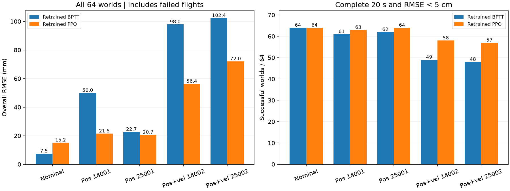
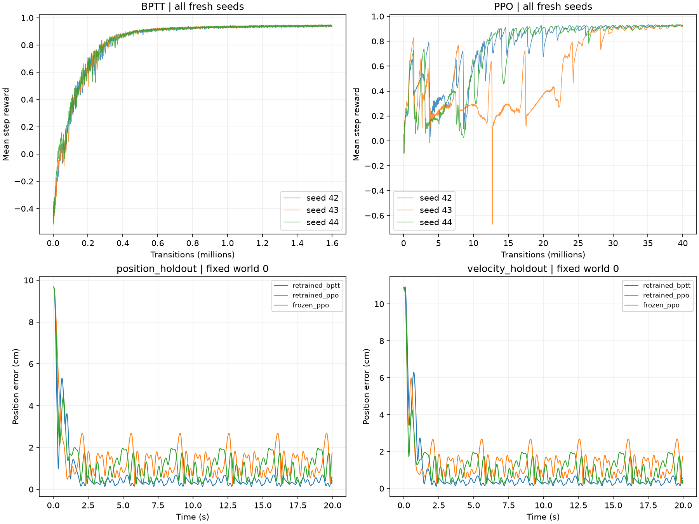

# 2026-11-25 最新实现：八字 BPTT / PPO 从头训练

在本轮固定配方下，BPTT的名义跟踪精度更高；位置、位置+速度扰动下，PPO总体误差更小、完成数不低且精度成功数更高。BPTT重训改善了原位置测试，但不能把名义精度当作扰动鲁棒性。

## 版本和任务

- Crazyflow官方main已核对仍为`aa54a0e8efc6fc8916cebbd737f3949d72b550fc`；训练时research HEAD为`6c7c00b5a3436fe9ceb81b69f24d6e916a5d23e6`。
- 官方实验源码使用当日main `203ad4e31b9380fec985f17008bb7a68ad5cf768`，独立checkout为`/tmp/crazyflow_experiments_20261125`。旧checkout与历史实验保持。7份关键训练器/Agent/env源码与旧固定版本逐字节相等，详见独立审计。
- 延续原本地高速研究：官方`5_5s`配方只将参考周期改为3.5秒，机型cf21B_500，first_principles，attitude动作，策略50Hz、物理500Hz。3.5秒属于本地扩展，未称为官方论文原任务。
- BPTT为16环境×64动作步，1.28秒的局部反传窗口；PPO为1024环境×32步。网络、优化器、参考preview和奖励分别沿用各自官方配方；训练reward不能跨算法直接比较。
- 两者训练均为名义动力学：PPO `dr_scale=0`，两者 `reset_random=False`。有不同轨迹相位起点和训练动作采样；没有训练本报告测试用的初态扰动、动力学DR或观测噪声。

## 完整训练预算和选模

全部从头初始化网络、优化器和环境，不加载旧checkpoint。每个种子只保存完整预算末尾权重；验证seed9001、64worlds、20秒，按完成率优先、总体RMSE次之选择。两种算法均选中seed42。

| 算法 | seed | 实际transitions | 训练秒数（含首次编译） | 验证RMSE mm | 完成 / 精度成功 |
|---|---:|---:|---:|---:|---|
| BPTT | 42 | 1,599,488 | 25.54 | 7.460 | 64/64 / 64/64 |
| BPTT | 43 | 1,599,488 | 22.65 | 7.571 | 64/64 / 64/64 |
| BPTT | 44 | 1,599,488 | 25.02 | 8.646 | 64/64 / 64/64 |
| PPO | 42 | 39,976,960 | 73.39 | 15.173 | 64/64 / 64/64 |
| PPO | 43 | 39,976,960 | 72.47 | 18.894 | 64/64 / 64/64 |
| PPO | 44 | 39,976,960 | 72.88 | 16.470 | 64/64 / 64/64 |

BPTT每seed请求1.6M、实际1,599,488步；PPO每seed请求40M、实际39,976,960步，均仅取完整update。六次训练总计**124,729,344 transitions**。这是各自历史预算的同版本比较，不是相同样本数、网络规模或算力预算的算法消融。CPU/GPU训练有并发，耗时不作为速度基准。尾段训练奖励仍在改善，不能由本轮有限预算宣称全局收敛。

## 同一评估设备上的全部结果

四份策略统一在CPU评估。每项64worlds、请求20秒，仅计首episode有效轨迹；终止/截断及autoreset后的状态排除。正常完整飞行计999个有效控制步，继承历史口径。总体RMSE包括失败world终止前的有效轨迹；同时报告完成数，未用幸存者RMSE替代总体成绩。精度成功要求完整飞行且该world全程RMSE<5cm。

位置扰动为各轴±0.1m，初速取参考速度；联合扰动还在最终reset之后加入各轴±0.5m/s真实初速，并刷新观测。25001/25002在本轮训练前预登记，为新测试种子；14001/14002保留历史可比性。BPTT先由独立选择记录固定权重再测试；最终两算法选择记录只使用validation。

| 场景 | 策略 | 总体RMSE mm | 完成 / 64 | 完成且RMSE<5cm / 64 |
|---|---|---:|---:|---:|
| 名义验证 9001 | 新训 BPTT seed42 | 7.460 | 64 | 64 |
| 名义验证 9001 | 新训 PPO seed42 | 15.173 | 64 | 64 |
| 名义验证 9001 | 旧 BPTT seed43 | 7.684 | 64 | 64 |
| 名义验证 9001 | 旧 PPO seed43 | 13.239 | 64 | 64 |
| 位置扰动 14001 | 新训 BPTT seed42 | 49.966 | 63 | 61 |
| 位置扰动 14001 | 新训 PPO seed42 | 21.473 | 64 | 63 |
| 位置扰动 14001 | 旧 BPTT seed43 | 75.323 | 58 | 56 |
| 位置扰动 14001 | 旧 PPO seed43 | 20.764 | 64 | 64 |
| 位置+速度扰动 14002 | 新训 BPTT seed42 | 97.968 | 51 | 49 |
| 位置+速度扰动 14002 | 新训 PPO seed42 | 56.350 | 62 | 58 |
| 位置+速度扰动 14002 | 旧 BPTT seed43 | 111.531 | 47 | 43 |
| 位置+速度扰动 14002 | 旧 PPO seed43 | 77.407 | 59 | 54 |
| 新位置扰动 25001 | 新训 BPTT seed42 | 22.693 | 64 | 62 |
| 新位置扰动 25001 | 新训 PPO seed42 | 20.663 | 64 | 64 |
| 新位置扰动 25001 | 旧 BPTT seed43 | 36.066 | 61 | 57 |
| 新位置扰动 25001 | 旧 PPO seed43 | 22.519 | 64 | 63 |
| 新位置+速度扰动 25002 | 新训 BPTT seed42 | 102.375 | 51 | 48 |
| 新位置+速度扰动 25002 | 新训 PPO seed42 | 72.043 | 61 | 57 |
| 新位置+速度扰动 25002 | 旧 BPTT seed43 | 97.178 | 49 | 45 |
| 新位置+速度扰动 25002 | 旧 PPO seed43 | 77.734 | 60 | 55 |

旧PPO本轮CPU位置RMSE为20.764mm；11月24日GPU冻结复测为20.758mm，存在浮点执行差异。这里所有横向表格使用同一CPU口径。四策略的各场景初始位置、速度、参考初值可逐值核对；各自官方preview造成参考时间离散化的极小差别仍保留，未训练后修改任务。





上图的world0按事先约定固定，不能代表全部64world的鲁棒性。BPTT在这个world上误差很小，但其他world发生失败；总体表格和全world柱图是主要比较依据。

## GPU与domain randomization的区别

PPO的物理仿真确实并行运行在GPU，而不只是网络在GPU：一步后的真实状态shape为`(1024,1,3)`，状态、观测与actor均在`cuda:0`，逐run记录在`actual_training_devices`。BPTT沿用官方CPU配方，状态shape为`(16,1,3)`。

GPU并行、训练动作采样和DR不是一回事。本轮PPO未启用DR，不能把其扰动测试优势归因于DR。BPTT同样能做随机初态、动力学参数或带噪观测训练；当前官方BPTT CLI未接入PPO的`dr_scale`参数，需要将已有可微随机化环境接入训练入口。对固定采样的参数/噪声，仍然可以对策略参数反传；速度扰动必须在参考速度reset之后注入，避免被覆盖。改变训练分布后，应重新验证学习率、反传窗口与预算，本轮没有执行这项新实验。

## 证据与复现

- [协议及源码/锁文件指纹](protocol.json)、[测试前BPTT选择](selected_bptt_before_test.json)、[最终验证选模](selected_before_test.json)。
- [全部比较与原始数组索引](comparison.json)、[独立源码/权重/NumPy审计](source_and_training_audit.json)。
- 每seed完整配置、权重及训练曲线SHA256、真实设备探针、全部64world NPZ均在本目录；六份新checkpoint位于`../../trained_models/figure8_retrain_20261125_*`。旧49份官方权重与原manifest保持一致。
- [训练入口](../retrain_figure8_20261125.py)；官方实验源码为固定commit，不修改Crazyflow核心或官方训练更新。

在恢复容器内运行：

```bash
cd /workspace/crazyflow
source /opt/crazyflow/activate-research.sh
JAX_PLATFORMS=cpu python usage_assets/retrain_figure8_20261125.py --algorithm bptt
python usage_assets/retrain_figure8_20261125.py --algorithm ppo
JAX_PLATFORMS=cpu python usage_assets/retrain_figure8_20261125.py --evaluate
```

已存在的本轮记录仅在源码/锁文件/协议/权重哈希一致时复用，绝不把复用记录称作新训练。未记录权重会拒绝覆盖；原始历史路径不写入。固定实验checkout缺失时会自动获取指定commit。
