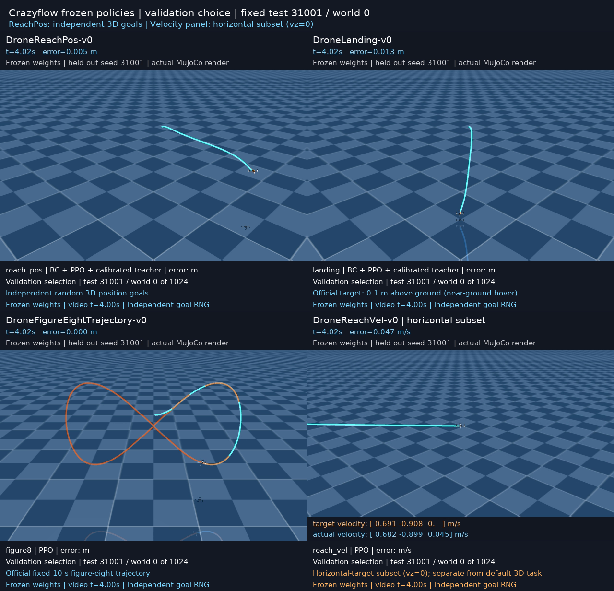

# 四个Gym任务完整训练与独立测试（2026-10-15）

21次完整训练均已结束：四任务×3 seeds的12次原配方，加ReachPos/Landing×3 seeds的6次校准教师配方、ReachVel gamma0.995×3 seeds的完整筛选晋级对照。
每次请求200M vector-step slots，4096×64整批向下取整为762 updates、
199,753,728 slots。忽略NEXT_STEP自动reset所占槽位后的有效transition另存，不混同两种计数。
额外两个ReachVel gamma筛选各50M只使用validation，不能充当完整演示候选。

原配方12run总slots：2,397,044,736；
所有完成研究run总slots（含校准/筛选）：4,294,443,008；
对应有效transitions：4,285,221,566。
ReachPos/Landing每run另有4,096,000 BC samples；PPO仍全预算跑完。

## 独立验证选择与冻结测试

验证seed20007、256world；按(success, survival, -RMSE)字典序选权重。
测试31001/31002/31003、每seed1024world，每个候选共3072首episode；失败保留。
测试成绩不参与模型、种子或checkpoint选择；视频固定31001/world0/1024world，无挑选画面。
每个run同时保存最佳和_last可恢复checkpoint。200M是完成的对照run预算，
best只经历选中update之前的优化，不能把之后的预算算到该权重；文件名200M也是run标签。
位置/近地的best另经历1000次BC优化、4,096,000教师样本；晚期改善和退化均照实保留。
配置/全历史/预算/置信区间/全部种子见[summary.json](summary.json)。

| 任务 | 验证集选中的配方/seed | 选中update | 独立成功数 | 全程RMSE | 最后观测秒RMSE |
|---|---|---:|---:|---:|---:|
| 三维到点 | reach_pos_s19_g0.99_200000000_calibrated | 100 (26,214,400 PPO slots) | 3071/3072 | 0.280591 | 0.027283 |
| 默认三维速度 | reach_vel_s7_g0.99_200000000 | 100 (26,214,400 PPO slots) | 1825/3072 | 0.164383 | 0.110298 |
| 近地悬停 | landing_s43_g0.99_200000000_calibrated | 762 (199,753,728 PPO slots) | 3072/3072 | 0.392864 | 0.023727 |
| 八字跟踪 | figure8_s43_g0.99_200000000 | 762 (199,753,728 PPO slots) | 3072/3072 | 0.024366 | 0.001376 |

ReachVel误差单位m/s，其余m。全程误差含初始到目标的过渡，不能当作稳态误差。
最后观测秒包括提前失败episode的末秒；须与成功数/完整时长一起阅读。
success要求完整10s、无termination、每world末秒RMSE<0.10；Figure8阈值0.15m；
Landing还要求末秒速度RMSE<0.10m/s，目标0.1m高，是近地悬停。

| 任务 | 教师配方 / gamma | 完整训练seed数 | test RMSE均值±种子std | test成功率均值±种子std |
|---|---|---:|---:|---:|
| 三维到点 | calibrated / 0.99 | 3 | 0.281862 ± 0.001118 | 99.9783% ± 0.0188% |
| 三维到点 | legacy / 0.99 | 3 | 0.283100 ± 0.000400 | 99.9783% ± 0.0188% |
| 默认三维速度 | legacy / 0.99 | 3 | 0.163955 ± 0.000511 | 59.3859% ± 0.0376% |
| 默认三维速度 | legacy / 0.995 | 3 | 0.167149 ± 0.000658 | 57.1940% ± 1.6305% |
| 近地悬停 | calibrated / 0.99 | 3 | 0.396046 ± 0.003491 | 99.9457% ± 0.0678% |
| 近地悬停 | legacy / 0.99 | 3 | 0.435503 ± 0.002419 | 100.0000% ± 0.0000% |
| 八字跟踪 | legacy / 0.99 | 3 | 0.024529 ± 0.000162 | 100.0000% ± 0.0000% |

种子std以独立训练run为单位；同一测试集在各模型间复用，不把它们池化成独立新增案例。

## 配方与审计

Crazyflow0.4.0、cf2x_L250、so_rpy、attitude四维指令；策略50Hz、10s episode。
actor/critic各2×128 Tanh，4096env×64steps，16minibatches×4epochs，LR3e-4线性退火，
主配方gamma0.99（速度晋级对照0.995）、GAE0.95、clip0.2、entropy0.002、value0.5、grad norm0.5、target KL0.03。
位置/近地任务使用BC+PPO+imitation(coef10)，并非纯PPO。
calibrated反解官方推力拟合的偏置/增益、稳态姿态增益及xyz欧拉几何；
[公式审计](../teacher_calibration_audit_20261015.json)与官方动力学加速度一致至3.05e-6m/s²。
其余奖励、环境和PPO参数不变，原配方对照完整保留。

另以纯校准PD解析控制器作参照（没有神经网络、没有训练epoch）：两任务均3072/3072成功，
到点全程RMSE0.34818m、近地0.43146m，尾秒分别约1.286e-5m/1.429e-6m。
到点神经策略整段误差更低，但少数失败/尾秒精度仍有差距；不同目标不压成单一最优结论。
[参照复现脚本](../teacher_reference_20261015.py)和[到点数据](teacher_reference_reach_pos.json)
明确标为analytic_controller_reference，未混入神经权重验证选择。

本轮发现旧reset同时用同一PRNG key初始化仿真和任务，ReachPos旧goal恒等于initial_pos+[0,0,-0.5]；
ReachVel目标也与初态耦合。因此旧到点成绩不能证明随机三维goal泛化。
已改为独立fold_in GOAL流，保留sim初态流，重新从头跑完整矩阵；
[1024world RNG审计](../goal_rng_audit_20261015.json)保留相关性/重复性证据。
旧权重仅作新协议下的baseline复评；禁止混协议续训。无效中间训练归档在被Git忽略的saves。

默认使用与官方NEXT_STEP等价的fused执行器；CPU/GPU状态/奖励差<1e-6，精确断点恢复已检查。
各run记录执行器hash与TF32设置；历史baseline以Python执行器、TF32=false复评。

## 实际仿真视频

[独立三维到点](best_reach_pos.mp4) · [近地悬停](best_landing.mp4) ·
[八字](best_figure8.mp4) · [默认三维速度失败](best_reach_vel.mp4) ·
[水平速度子集](best_reach_vel_horizontal.mp4)。

所有画面由冻结策略驱动真实MuJoCo状态。
[replay_manifest.json](replay_manifest.json)记录权重/原始NPZ/视频hash、逐步状态误差和帧核验。
默认速度world0在2.92s失败，之后1s只是失败提示停帧；不算飞行时长。
水平vz=0是另一明确标记的子分布，不能代替默认三维任务。

## 完整复现

在research Docker内的/workspace/crazyflow执行：

~~~bash
python usage_assets/fulltrain_20261015.py suite
python usage_assets/fulltrain_20261015.py suite --tasks reach_pos landing --teacher-model calibrated
python usage_assets/fulltrain_20261015.py suite --tasks reach_vel --gamma 0.995
python usage_assets/fulltrain_20261015.py baseline
python usage_assets/fulltrain_20261015.py worker --task reach_vel --seed 7 --gamma 0.995 --steps 50000000 --validation-only
python usage_assets/fulltrain_20261015.py worker --task reach_vel --seed 7 --gamma 0.999 --steps 50000000 --validation-only
python usage_assets/teacher_reference_20261015.py
python usage_assets/summarize_fulltrain_20261015.py
MUJOCO_GL=egl python usage_assets/build_gym_gallery_20261015.py watch --once
python usage_assets/verify_fulltrain_20261015.py --require-complete
~~~

suite跳过已完成JSON；重新从头实验应先将相应JSON/weights另存，而不是覆盖已有核验结果。
断点恢复使用单run worker --resume trained_models/gym_<tag>_last.pt，且配置和teacher_model须一致。
有限预算、这些参数族和测试分布提供已验证表现，不构成全局最优或硬件绝对边界证明。
