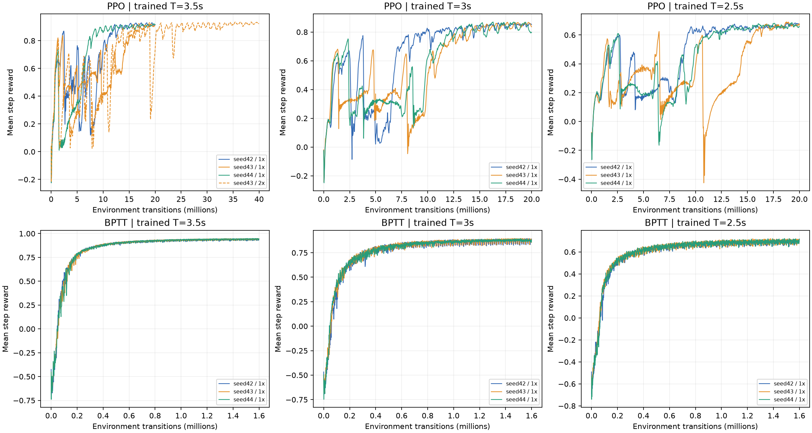

# 本地专门高速训练扩展（2026-10-15）

这项实验针对更快参考周期从头训练，不是把5.5s策略迁移失败当项目上限，也不是声称复现了
论文中未发表的高速结果。官方源码固定bfc6414；沿用5_5s的全部网络/奖励/优化参数与preview，
唯一训练任务改动是trajectory_time，分别3.5/3.0/2.5s。PPO完整20M、BPTT完整1.6M，
各seeds42/43/44。机型cf21B_500，名义first_principles、attitude控制、物理500Hz/控制50Hz。

每种算法/周期的权重仅由validation seed9001选择：完整20s比例优先，再选最低RMSE。
独立test seed14001添加位置±0.1m（初速精确参考）；压力seed14002同时添加位置±0.1m和
真正速度扰动±0.5m/s，速度在所有reset结束后显式注入并刷新策略观测。
每项64world、20s，保留全部失败种子；到结束/终止后的autoreset状态不计入。
全程精度成功=完整20s且RMSE<5cm，不用幸存者误差替代所有world的主指标。

## 全部独立训练

| 算法 | 周期s | seed | 预算倍数 | 实际transitions | 验证RMSE mm | 完整20s | <5cm | 末10%奖励改善 |
|---|---:|---:|---:|---:|---:|---:|---:|---:|
| BPTT | 2.5 | 42 | 1 | 1,599,488 | 143.65 | 100.00% | 0.00% | 0.0037 |
| BPTT | 2.5 | 43 | 1 | 1,599,488 | 128.96 | 100.00% | 0.00% | 0.0035 |
| BPTT | 2.5 | 44 | 1 | 1,599,488 | 150.88 | 100.00% | 0.00% | 0.0032 |
| BPTT | 3.5 | 42 | 1 | 1,599,488 | 8.66 | 100.00% | 100.00% | 0.0012 |
| BPTT | 3.5 | 43 | 1 | 1,599,488 | 8.56 | 100.00% | 100.00% | 0.0019 |
| BPTT | 3.5 | 44 | 1 | 1,599,488 | 8.61 | 100.00% | 100.00% | 0.0019 |
| BPTT | 3 | 42 | 1 | 1,599,488 | 33.20 | 100.00% | 98.44% | 0.0026 |
| BPTT | 3 | 43 | 1 | 1,599,488 | 37.04 | 100.00% | 95.31% | 0.0023 |
| BPTT | 3 | 44 | 1 | 1,599,488 | 42.19 | 100.00% | 87.50% | 0.0026 |
| PPO | 2.5 | 42 | 1 | 19,988,480 | 151.71 | 100.00% | 0.00% | 0.0128 |
| PPO | 2.5 | 43 | 1 | 19,988,480 | 161.64 | 100.00% | 0.00% | 0.0166 |
| PPO | 2.5 | 44 | 1 | 19,988,480 | 160.12 | 100.00% | 0.00% | -0.0027 |
| PPO | 3.5 | 42 | 1 | 19,988,480 | 21.95 | 100.00% | 100.00% | 0.0016 |
| PPO | 3.5 | 43 | 1 | 19,988,480 | 31.38 | 100.00% | 100.00% | 0.0278 |
| PPO | 3.5 | 44 | 1 | 19,988,480 | 24.69 | 100.00% | 100.00% | 0.0048 |
| PPO | 3.5 | 43 | 2 | 39,976,960 | 13.58 | 100.00% | 100.00% | 0.0077 |
| PPO | 3 | 42 | 1 | 19,988,480 | 75.48 | 100.00% | 0.00% | 0.0068 |
| PPO | 3 | 43 | 1 | 19,988,480 | 64.04 | 100.00% | 0.00% | 0.0090 |
| PPO | 3 | 44 | 1 | 19,988,480 | 48.81 | 100.00% | 64.06% | -0.0001 |

## 固定验证规则选出的权重与独立holdout

| 算法 | 周期s | seed/预算 | Val mm / <5cm | Pos mm / <5cm | Vel mm / <5cm |
|---|---:|---:|---|---|---|
| PPO | 3.5 | 43/2x | 13.58 / 100.00% | 19.63 / 100.00% | 65.48 / 90.62% |
| PPO | 3 | 44/1x | 48.81 / 64.06% | 52.24 / 59.38% | 60.74 / 46.88% |
| PPO | 2.5 | 42/1x | 151.71 / 0.00% | 153.46 / 0.00% | 156.34 / 0.00% |
| BPTT | 3.5 | 43/1x | 8.56 / 100.00% | 52.25 / 95.31% | 132.50 / 73.44% |
| BPTT | 3 | 42/1x | 33.20 / 98.44% | 38.27 / 85.94% | 48.25 / 68.75% |
| BPTT | 2.5 | 43/1x | 128.96 / 0.00% | 130.86 / 0.00% | 133.11 / 0.00% |

“末10%奖励改善”是最后10%迭代均值减前一10%均值，JSON还保留季度指标和尾段标准差；
曲线和真实指标一起阅读，
不把正斜率自动当作充分收敛，也不把失败种子隐藏。
结果限定本地有限预算、固定官方超参数族和这些任务分布，不能声称全局最优或机型绝对物理极限。

## 复现

~~~bash
python usage_assets/official_frontier_20261015/run.py
python usage_assets/official_frontier_20261015/run.py --report-only
~~~

可用--algorithm ppo或bptt分开运行；--periods和--seeds指定子集，
--budget-multiplier 2进行有限预算对比。每个checkpoint名称唯一，不覆盖此前30次官方训练。
权重在trained_models/official_frontier_*；原始数据、初始真值、曲线和完整配置在本目录。
eval JSON与NPZ可用既有official_report_20261015.verify重新计算RMSE/失败/精度成功，
SHA256标识固定权重。训练源码及参数出处：
[官方PPO](https://github.com/learnsyslab/crazyflow_experiments/blob/bfc6414da1f4405e4e41e3a3d0656bb5f38e09e3/crazyflow_experiments/figure8/train_ppo.py)
与 [官方BPTT](https://github.com/learnsyslab/crazyflow_experiments/blob/bfc6414da1f4405e4e41e3a3d0656bb5f38e09e3/crazyflow_experiments/figure8/train_bptt.py)。

## 官方完整训练配方

采用固定commit的Args.create("5_5s")。PPO：1024env×32steps，32minibatches、15epochs，
actor/critic LR=0.0003/0.004且anneal_lr=true，gamma=0.96、GAEλ=0.94、clip=0.5，
entropy=0.007、value coef=0.7、hidden_size=32、init_logstd=-1；参考preview为11×0.06s。
BPTT：16env×64steps，actor LR=0.01且不退火，gamma=1、hidden_size=12，
init_logstd=-1，参考preview为12×0.04s。两者rpy_coef=0.1，DR=0；
动作/动作差分奖励系数随完整config逐项保存。
基础PPO20M请求对应610次完整update、19,988,480transitions；BPTT1.6M请求对应
1,562次完整update、1,599,488transitions。40M PPO为1,220次update、39,976,960transitions。
hyperparameter_audit.json逐run核对官方preset：除seed、预算/派生迭代数和参考周期外无参数改动。
参数出处是上方固定版本的官方PPO/BPTT源码；每个训练JSON完整config可直接构造Args重跑。

## 有限延训与结果边界

18个基础run结束后，只根据训练奖励最后10%相对前10%的改善幅度选择一个延训对照，
没有用测试集选择延训对象。PPO3.5s seed43的改善幅度最大（+0.02784），因此额外从头跑
40M预算，实际39,976,960步；validation误差由31.38mm降到13.58mm，按相同验证规则选中。
末段数值和全部曲线见budget_extension_result.json；有限延训也不证明全局最优。

专门训练已把原冻结5.5s策略的3.5s迁移失败推进为稳定名义跟踪：两个算法全部三个种子
validation均64/64完整且<5cm。位置holdout中，选中的PPO3.5s为19.63mm、
64/64完整且<5cm；BPTT3.5s为52.25mm、61/64完整且<5cm。
加真实初速扰动后，PPO为65.48mm、61/64完整、58/64<5cm；BPTT为132.50mm、
49/64完整、47/64<5cm。BPTT名义初始化更准，PPO对这些位置/速度扰动更稳健。
这也说明名义初始化的8.56mm不能当作任意初态的泛化保证。

3.0s BPTT validation为33.20mm、63/64<5cm，位置holdout为38.27mm、55/64；
PPO分别48.81mm/41和52.24mm/38。2.5s所有基础run仍飞完整20s，
但validation约129–162mm、全部0/64<5cm，轨迹精度未通过；不能用存活包装成功。

名义控制包络另见nominal_control_envelope.json：机体质量43.4g，单电机命令上限0.2N，
总0.8N，忽略阻力/姿态耦合时最大向上加速度约8.62m/s²。
参考3.0/2.5s的峰值向上加速度约8.77/12.63m/s²，提供性能下降的动力学线索；
它不是这台机型所有轨迹/参数/控制方法的绝对速度上限，也不能代替完整可达性分析。

## 实际MuJoCo回放

[最快全部validation通过且误差最低的BPTT3.5s](best_dedicated_speed.mp4)：
选择规则仅使用验证集，固定独立seed14001/world0，完整位置扰动，不挑最好world。
[位置holdout更稳健的PPO3.5s](ppo_T3.5s_position_holdout.mp4)同样固定seed/world；
两个视频都由冻结策略逐步驱动实际仿真状态，未用参考轨迹冒充飞行状态。
各自_replay.json记录检查点哈希和与原始评估状态的最大差异，_replay_states.npz保留真状态。
视频是仿真回放，未启动实飞。

## 一键完整复现与核验

~~~bash
bash usage_assets/official_frontier_20261015/reproduce.sh
~~~

此命令覆盖完整18run、固定40M对照、验证/两个新holdout、图表、33场景重算和两个视频。
已存在且哈希一致的checkpoint跳过训练。单独核验用finish.py；不混入旧30run/126场景统计。
artifact_verification.json记录19run总实际步数和33项完整场景。
