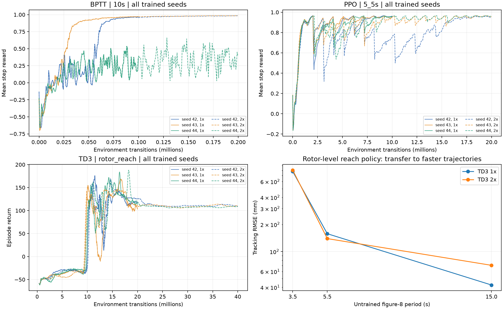
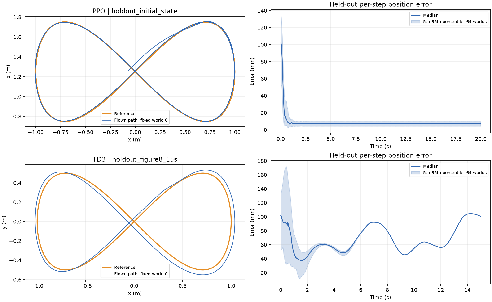

# 2026-10-15 官方策略完整训练与能力边界

这是本机 Docker 中的仿真训练和评估，没有实飞。
外部源码固定为 [bfc6414](https://github.com/learnsyslab/crazyflow_experiments/tree/bfc6414da1f4405e4e41e3a3d0656bb5f38e09e3)。
官方仓库没有提供策略 checkpoint，以下权重全部重新训练。

## 方法与完整预算

每个配置独立训练 seeds 42/43/44，分别使用完整官方预算和 2 倍预算。
2 倍预算从头训练，保留原超参数及其学习率退火规则；不是从只保存 actor 的 checkpoint 接续训练。
validation seed 9001 用于选择演示 checkpoint，test seed 10001 用于报告 holdout，每项 64 worlds。

Figure8 是 first_principles + attitude（姿态加集体推力），TD3 是 first_principles + rotor_vel，
直接输出四电机命令。Figure8机型为 cf21B_500（brushless），TD3为 cf2x_L250（brushed），
不能把不同机型成绩当作控制接口的公平消融。
标准四旋翼为 6 自由度、4 输入的欠驱动系统；没有模拟损失旋翼，
也不代表固定翼飞机。物理积分 500 Hz；Figure8 控制 50 Hz、评估 20 s；
TD3 控制 100 Hz，到点最多 7 s，未见八字任务分别 15/5.5/3.5 s。

只计算每个 world 首个 episode，排除 SAME_STEP autoreset 后状态，保存全部失败种子。
alive_without_crash_rate 是没有越界的比例，成功到点提前结束也计入；
full_horizon_completion_rate 是完整时长比例，到点成功提前结束时可以是 0。
到点成功必须位置误差 <5 cm 且速度 <5 cm/s，以 goal_success_rate 判断；
轨迹精度成功定义为完整存活且全程 RMSE <5 cm，另外记录末秒误差 <10 cm。

Figure8 nominal 与训练使用相同参考轨迹，holdout 检查不同初态和物理参数，不声称未见轨迹。
初态扰动实际只有位置 ±0.1 m；官方随机 reset 虽抽取速度 ±0.5 m/s，但随后 reset_velocity
会覆盖为精确参考速度。已实际检查 nominal/holdout 初速与参考的最大差均为 0，不能声称速度
holdout。DR 0.2 是官方 ranges 的 0.2 倍：
质量/惯量/电机动态 ±4%，推力/力矩曲线 ±2%，常值外力每轴 ±0.008 N、
常值力矩 ±4e-5 Nm，白噪声标准差 0.01 N/2e-4 Nm，动作延迟最多 8 ms。
DR 1.0 为上述 5 倍；两种 DR 同时包含初态扰动，均未用于训练。
TD3 只训练固定点到达，八字是未见任务，不能以这些迁移成绩代替专门高速跟踪训练。

参数缩放均为各 world、各电机/系数独立的均匀分布 U(1-r,1+r)；惯量逐轴缩放用
D J D 合同变换并同步更新逆矩阵，保持对称正定。常值外力/力矩为每轴均匀分布 U(-w,w)，
噪声为每个 500 Hz 物理 tick 独立的无截断零均值 Gaussian。延迟按 2 ms 物理 tick
在 0..max_ticks 离散均匀抽样；scale0.2 最大 4 ticks，scale1 最大 20 ticks。
scale1 的质量/惯量/电机系数缩放在 [0.8,1.2]，推力/力矩曲线在 [0.9,1.1]，
不会仅因这些正缩放而产生负质量或非正定惯量。但各曲线系数独立扰动，没有强制整个 RPM
范围的推力非负/单调或耦合物理一致性，也没有实测校准这些参数组合；Gaussian 外扰无硬上限。
因此强扰动只是公开定义的压力分布，不能把它称为所有物理机型的认证或真实故障分布。

首次训练计时含编译，后续相同形状复用编译。论文的训练秒数排除了 JIT 预热，不能直接比较。
保存每次实际 transitions、seed、完整超参数、源码 commit 和 checkpoint SHA256。

| 算法/任务 | 预算 | 实际步数/seed | 验证 RMSE mm（均值±std） | 验证完整时长/到点成功 |
|---|---:|---:|---:|---:|
| BPTT/10s | 1x | 99,840 | 382.91 ± 649.59 | 66.67% |
| BPTT/10s | 2x | 199,680 | 209.70 ± 357.73 | 66.67% |
| BPTT/5_5s | 1x | 799,744 | 3.21 ± 0.41 | 100.00% |
| BPTT/5_5s | 2x | 1,599,488 | 1.68 ± 0.25 | 100.00% |
| PPO/10s | 1x | 1,998,848 | 1.19 ± 0.24 | 100.00% |
| PPO/10s | 2x | 3,997,696 | 914.14 ± 960.35 | 48.44% |
| PPO/5_5s | 1x | 9,994,240 | 10.34 ± 2.62 | 100.00% |
| PPO/5_5s | 2x | 19,988,480 | 11.65 ± 4.68 | 100.00% |
| TD3/rotor_reach | 1x | 19,996,672 | 248.31 ± 4.82 | 100.00% |
| TD3/rotor_reach | 2x | 39,997,440 | 253.81 ± 25.34 | 95.31% |

到点误差包含初始随机偏移，不是悬停稳态精度；到点任务主要看到点成功率与时间。
失败种子在以上均值中保留，没有仅用幸存者误差美化结果。

## 独立 validation 选择的策略

PPO/BPTT 按完整时长优先、nominal RMSE 最小选择；TD3 按验证到点成功率优先、平均到点时间最短选择。
视频固定 test world0，没有按测试画面挑 world。不同控制接口的数据不互相替代。

| 演示 | seed/预算 | validation | test 初态/到点 | test DR 0.2 | DR 1.0 边界 |
|---|---|---|---|---|---|
| ppo_slow | 44 / 1x | 1.01mm | 10.11mm / 100.00% | 11.54mm / 100.00% | 57.80mm / 95.31% |
| ppo_fast | 44 / 2x | 7.41mm | 12.64mm / 100.00% | 13.58mm / 100.00% | 163.01mm / 85.94% |
| bptt_slow | 43 / 2x | 2.36mm | 14.09mm / 100.00% | 22.63mm / 100.00% | 185.17mm / 65.62% |
| bptt_fast | 44 / 2x | 1.48mm | 10.70mm / 100.00% | 11.77mm / 100.00% | 196.53mm / 56.25% |
| td3 | 42 / 2x | 到点 100.00%, 1.017s | 到点 98.44%, 1.143s | 见未见任务表 | 见未见任务表 |

## 直接电机 TD3 的未见轨迹边界

所有三种子平均，失败照常计入；到点策略的跨任务迁移边界不能当成 Crazyflow 的全局能力上限。

| 训练预算 | 未见八字周期 | RMSE (mm) | 完整时长存活 | 全程 <5cm 成功 |
|---|---:|---:|---:|---:|
| 1x | 15s | 42.50 | 100.00% | 89.06% |
| 1x | 5.5s | 157.91 | 100.00% | 0.00% |
| 1x | 3.5s | 776.14 | 0.00% | 0.00% |
| 2x | 15s | 70.32 | 100.00% | 0.00% |
| 2x | 5.5s | 139.33 | 100.00% | 0.00% |
| 2x | 3.5s | 803.63 | 0.00% | 0.00% |

## DR 参数物理性审计

按本次相同 seed10001、64 worlds、cf21B_500 重新抽样参数：DR0.2 的惯量全部满足
正定及刚体三角不等式 I1+I2≥I3；DR1.0 虽保持正定，却有 **19/64** 违反三角不等式，
这些惯量组合不能由物理刚体实现。因此 DR1.0 的总失败率包含不物理压力样本，不能解释成
真实硬件失效概率或机型物理极限。质量在两档都为正。以原 rotor 动作区间
6962.07–21302.28 RPM 的 256 点网格检查，两档均未出现负推力或负推力斜率；
该有限采样检查不替代完整曲线/硬件物理认证。

[审计数据](official_dr_physical_audit_20261015.json) 保存范围、惯性条件与world索引，
每档 NPZ 保存实际质量/惯量/推力系数。用 official_dr_audit_20261015.py 可重新计算。

## 真正初速度与姿态 holdout

为补足官方reset速度覆盖，另外对上述5个冻结权重运行
[真正扰动报告](official_stress_20261015_results.md)：
每项64 worlds，速度独立seed11001，姿态独立seed11002；显式在全部reset后注入并刷新观测。
PPO慢/快、BPTT快两项均64/64完整存活且全程误差<5cm；BPTT慢的速度项完整存活64/64，
但精度成功62/64。所选rotor TD3速度项62/64到点、2个超时且无越界，姿态项64/64到点。
这些是新增初态分布的独立测试，不是 nominal 完美初始化下的泛化声明。

## 收敛证据与限制

慢 BPTT 的 seed44 在官方预算失稳，翻倍后仍失稳；PPO 慢配置翻倍会变差。快 BPTT 加倍改善
标称精度，但物理压力下仍会失败。TD3 加倍没有解决 3.5 s 未见轨迹，也没有稳定提升全部速度。
因此保留全部预算/种子，按独立验证集挑权重，不自动展示最长训练或最后一轮。
tracking_rmse_m 对所有world终止前有效样本加权，
提前失败会缩短有效时长，所以必须同时阅读失败率/完整时长；没有用幸存者误差替代主指标。

本机毫米级结果依赖精确状态观测、指定轨迹和标称仿真，不代表实飞已经达到该精度。
专门训练高速 rotor tracking、视觉导航、旋翼失效恢复和实机部署均未由这些实验验证。
[论文](https://arxiv.org/html/2606.01478v1) 的慢轨迹 PPO/BPTT 预算为 2M/100k，
快轨迹为 10M/800k，TD3 为 20M，
以及其真实飞行结果，属于不同实验。本地源码包括
[Figure8 配置](https://github.com/learnsyslab/crazyflow_experiments/blob/bfc6414da1f4405e4e41e3a3d0656bb5f38e09e3/crazyflow_experiments/figure8/train_ppo.py)
和 [TD3 配置](https://github.com/learnsyslab/crazyflow_experiments/blob/bfc6414da1f4405e4e41e3a3d0656bb5f38e09e3/crazyflow_experiments/learn2fly/train.py)。

## 名义物理下的速度泛化扫描与RNG审计

[冻结策略速度扫描](official_speed_sweep_20261015_results.md) 固定新test seed12001，每项64world，
不改preview或权重，只加快参考周期。PPO/BPTT在4.5s（峰速1.975m/s、峰加速度4.143m/s²）
均64/64全程误差<5cm，RMSE分别16.39/6.22mm。3.5s（峰速2.539m/s）时，
PPO完整60/64、精度成功58/64；BPTT两者26/64。2.5/1.5s两套冻结策略均全部提前失败。
这比不物理DR1.0更适合描述该冻结策略的速度迁移边界，仍不是专门重训后的机型物理极限。

另核查官方到点任务RNG：goal先使用独立split子key，再由sim reset将保留key拆成position、
velocity、angular-velocity子key。1024world、seed13001的实际pos-vel相关为0.001625；
仅用于检查key复用的扩大goal范围诊断，pos-goal相关为-0.000869，goal-pos误差方差明显非零。
默认官方TD3任务goal仍固定[0,0,1.5]，这项RNG诊断没有评估策略，不声称随机3D goal泛化。
[审计数据](official_rng_audit_20261015.json) 与 official_rng_audit_20261015.py 可复算。

## 固定 test world0 的实际 MuJoCo 回放

最直观的高速演示为 [PPO 4.5s周期](official_speed_sweep_20261015_ppo_T4.5s.mp4)，
这是5.5s训练权重在扫描中最快仍64/64全程<5cm通过的参考周期；
[同权重2.5s失败短片](official_speed_sweep_20261015_ppo_T2.5s.mp4) 保留实际失败。
两段固定新test seed12001/world0，回放与扫描raw的最大差均<0.1mm，未按新测试挑权重。

- [PPO快轨迹，20M预算](official_ppo_5_5s_budget2_20261015_seed44_holdout_initial_state.mp4)
- [BPTT快轨迹，1.6M预算](official_bptt_5_5s_budget2_20261015_seed44_holdout_initial_state.mp4)
- [直接电机TD3到点，40M预算](official_td3_rotor_reach_budget2_20261015_seed42_holdout_hover.mp4)
- [同一TD3的15s未见轨迹](official_td3_rotor_reach_budget2_20261015_seed42_holdout_figure8_15s.mp4)
- [3.5s迁移失败](official_td3_rotor_reach_budget2_20261015_seed42_holdout_figure8_3.5s.mp4)

全部来自冻结权重重新模拟，固定test seed10001/world0。对应 sidecar 记录结束原因、
权重SHA256以及与原批量评估的最大位置差（五段均<0.4mm）。

## 复现和证据

在 note.md 的研究 Docker 内、项目根目录运行：

~~~bash
python usage_assets/official_policy_20261015.py --algorithm bptt
python usage_assets/official_policy_20261015.py --algorithm ppo
python usage_assets/official_policy_20261015.py --algorithm td3
python usage_assets/official_policy_20261015.py --algorithm bptt --budget-multiplier 2
python usage_assets/official_policy_20261015.py --algorithm ppo --budget-multiplier 2
python usage_assets/official_policy_20261015.py --algorithm td3 --budget-multiplier 2
python usage_assets/official_report_20261015.py
~~~

依赖 fire/flax/jax/optax/wandb/NumPy/Matplotlib 均在现有容器内，W&B 上传禁用。
外部 checkout 默认 /tmp/crazyflow_experiments，不存在则自动 clone 官方并固定 commit；
eval-only 从 trained_models/official_*.ckpt 重载冻结策略，保留原训练元数据。
选择结果及 SHA256 见 official_policy_20261015_selected.json。

每个 seed 的 JSON 保存完整指标和每world RMSE，training.npz 保存每次迭代曲线。
场景 NPZ 的 full_error_sq/full_active/full_terminated/full_truncated/full_success 保留
64 worlds 每一步的误差与首episode mask，可复算全统计；pos/target/action 保存固定 world0。
旧批次未记录真值速度，velocity_estimate_finite_difference 明确为数值差分估计；
新批次的 vel/quat 和视频 sidecar 保留仿真真值状态。到点成功始终由原环境真值速度条件决定。

视频通过 official_replay_20261015.py 重载冻结权重、重新模拟并用 MuJoCo EGL 渲染。
sidecar JSON 保存 checkpoint SHA256、结束原因和与原评估最大位置差，
独立的 replay_states.npz 保存回放实际状态，不覆盖原批量评估 NPZ。

~~~bash
MUJOCO_GL=egl python usage_assets/official_replay_20261015.py \
  --checkpoint trained_models/official_ppo_5_5s_budget2_20261015_seed44.ckpt \
  --scenario holdout_initial_state
MUJOCO_GL=egl python usage_assets/official_replay_20261015.py \
  --checkpoint trained_models/official_td3_rotor_reach_budget2_20261015_seed42.ckpt \
  --scenario holdout_hover
MUJOCO_GL=egl python usage_assets/official_replay_20261015.py \
  --checkpoint trained_models/official_td3_rotor_reach_budget2_20261015_seed42.ckpt \
  --scenario holdout_figure8_3.5s
~~~
