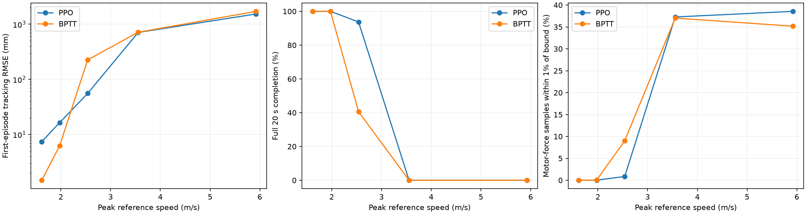

# 2026-10-15 名义动力学下的冻结策略速度扫描

仅测试已用独立validation seed9001选出的 PPO/BPTT 5.5s checkpoint，
不重新训练、不按本扫描挑权重。所有场景为原始 cf21B_500、名义first_principles参数，
每项64world、固定新test seed12001、评估20s、控制50Hz/物理500Hz。
只把官方周期参考的 trajectory_time 改成5.5/4.5/3.5/2.5/1.5s，
保持actor、n_samples、samples_dt、动作范围和preview不变。初始位置/速度按新参考正确初始化，
本扫描不替代另外的真正初速/姿态扰动测试。

峰值参考速度/加速度来自官方 Figure8.vel/acc 解析导数，对完整一周期取10001点网格峰值。
策略动作饱和=有效首episode样本中 roll/pitch/thrust 三个归一化输出 |a|≥0.99 的比例；
yaw由官方ZeroYaw固定为0，不混入分母。另记录每个控制tick最后一个物理子步的四电机
命令推力位于控制器thrust_min/max的1%范围内的比例，作为实际分配器接近限幅的指标；
这不是全部500Hz子步的计数。近地world定义为有效样本中任意高度≤2.5cm，
只是高度代理，不是MuJoCo几何接触查询。失败后的autoreset动作不计入。

| Model | T s | vmax | amax | RMSE mm | 20s | <5cm | Action sat. | Motor sat. | Near floor |
|---|---:|---:|---:|---:|---:|---:|---:|---:|---:|
| PPO | 5.5 | 1.616 | 2.773 | 7.41 | 100.00% | 100.00% | 0.00% | 0.00% | 0.00% |
| PPO | 4.5 | 1.975 | 4.143 | 16.39 | 100.00% | 100.00% | 0.00% | 0.03% | 0.00% |
| PPO | 3.5 | 2.539 | 6.848 | 55.54 | 93.75% | 90.62% | 0.16% | 0.85% | 3.12% |
| PPO | 2.5 | 3.554 | 13.423 | 709.36 | 0.00% | 0.00% | 22.22% | 37.28% | 40.62% |
| PPO | 1.5 | 5.924 | 37.285 | 1534.57 | 0.00% | 0.00% | 37.48% | 38.56% | 32.81% |
| BPTT | 5.5 | 1.616 | 2.773 | 1.48 | 100.00% | 100.00% | 0.00% | 0.00% | 0.00% |
| BPTT | 4.5 | 1.975 | 4.143 | 6.22 | 100.00% | 100.00% | 0.00% | 0.05% | 0.00% |
| BPTT | 3.5 | 2.539 | 6.848 | 226.28 | 40.62% | 40.62% | 2.64% | 9.00% | 23.44% |
| BPTT | 2.5 | 3.554 | 13.423 | 715.16 | 0.00% | 0.00% | 23.75% | 37.03% | 26.56% |
| BPTT | 1.5 | 5.924 | 37.285 | 1712.58 | 0.00% | 0.00% | 44.76% | 35.17% | 23.44% |

[最快64/64精度通过的PPO 4.5s实际回放](official_speed_sweep_20261015_ppo_T4.5s.mp4)
与 [同权重2.5s失败边界](official_speed_sweep_20261015_ppo_T2.5s.mp4)
固定seed12001/world0，字幕明确 trained5.5s/test4.5s 或 test2.5s，保持原验证集选出的
checkpoint。回放与扫描原始world0的最大位置差分别0.071/0.043mm。

~~~bash
MUJOCO_GL=egl python usage_assets/official_replay_20261015.py   --checkpoint trained_models/official_ppo_5_5s_budget2_20261015_seed44.ckpt   --trajectory-time 4.5
MUJOCO_GL=egl python usage_assets/official_replay_20261015.py   --checkpoint trained_models/official_ppo_5_5s_budget2_20261015_seed44.ckpt   --trajectory-time 2.5
~~~

所有world和失败均保留。RMSE基于首episode终止前有效样本，提前失败会缩短样本时长；
需同时看完整20s、<5cm成功率和近地比例。本扫描测量的是两套固定5.5s策略在新速度参考下的
泛化边界，不能等同于专门重训后的能力或该机型的绝对物理速度极限。

复现：python usage_assets/official_speed_sweep_20261015.py。
JSON保存固定checkpoint SHA、preview参数、逐轴动作峰值、每world误差和全统计。
NPZ保存全world逐step误差/mask/动作与电机饱和bool、全部初始真值，以及world0实际位置、
参考、速度、姿态、动作和电机推力。无动力学随机化，因此不含DR1.0不物理惯量组合。
