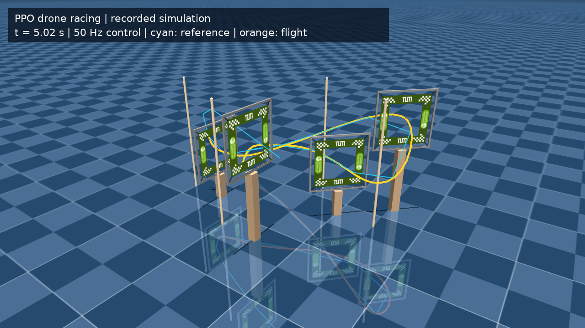
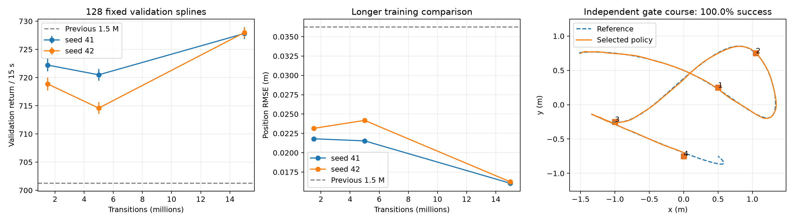

# Racing PPO 完整训练与能力边界（2026-10-15）

本轮完成两个独立 seed 的完整 15M 预算训练，共 **29,999,104 个有效 transitions**。冻结的最佳验证权重在独立 256 条随机参考上达到 **1.5966 cm 位置 RMSE**；原生固定赛道 64/64 完成四门，速度迁移测试 64/64 完成四门，平均 **6.6591 s**。门框和障碍物位置也随机化的 level2 只有 **16/64** 成功，这给出了当前固定规划器与跟踪策略组合的实际边界。

直接查看 [快速四门视频](racing_fulltrain_20261015_fast_course.mp4)、[常速四门视频](racing_fulltrain_20261015_course.mp4)、[完整原始结果](racing_fulltrain_20261015.json) 和 [训练/轨迹图](racing_fulltrain_20261015.png)。所选权重为 [seed42 / 15M checkpoint](../trained_models/racing_s42_15000000_20261015.ckpt)。本报告的“最佳”指下述固定验证规则在本轮候选集合中的选择。



## 训练对象和配方

Crazyflow 已同步官方 0.4.0；外部 racing 固定在 `065a6ecb7a7621f156bdd0bedc70020e3331a3e9`。策略训练对象是欠驱动四旋翼 `cf21B_500` 的随机样条跟踪，通过 roll、pitch 和总推力控制耦合位置动力学，yaw 命令固定为零。动力学和姿态控制频率 500 Hz，策略频率 50 Hz，每条参考 15 s / 750 步。前 3 个样条结点固定用于起飞，后 7 个随机；共同的起飞前缀属于任务定义。

网络、PPO loss 和优化器沿用 [固定提交的官方 trainer](https://github.com/learnsyslab/lsy_drone_racing/blob/065a6ecb7a7621f156bdd0bedc70020e3331a3e9/lsy_drone_racing/control/train_rl.py)。本仓库的 [完整训练脚本](racing_fulltrain_20261015.py) 在内存中插入检查点与正确的 time-limit bootstrap，并修复环境的 episode 处理；这些改动和原始 trainer 的差别如下节所述。

| 参数 | 本轮值 |
|---|---|
| actor / critic | 各 2×64 tanh；73D observation / 4D action |
| 并行环境 / rollout | 1,024 worlds × 8 steps |
| batch / minibatch / epochs | 8,192 / 1,024 / 10 |
| optimizer | AdamW，初始 learning rate 0.0015，eps=1e-5 |
| learning rate schedule | 按完整 15M horizon 线性退火 |
| gamma / GAE lambda | 0.94 / 0.97 |
| PPO clip / entropy coefficient | 0.26 / 0.007 |
| value coefficient / max grad norm | 0.7 / 1.5 |
| reward coefficients | rpy=0.06，thrust action change=0.4，xy action change=1.0，action=0.02 |
| training seeds | 41、42 |

这是每个 seed 连续训练到 15M、沿途保存 1.5M / 5M / 15M 的比较。早期检查点使用同一条 15M learning-rate schedule；不能把它们解释成分别按各自预算退火至零的三个独立配方。未使用 BC 教师。训练使用随机参考，不包含赛道门框碰撞训练。

## Episode、PRNG 和惯量检查

适配器使用 SAME_STEP 自动重置，保存 terminal observation；重置时清空 observation history 和 last action，并生成新样条。配置的 action disturbance 在实际执行链路中生效。验证阶段保存并恢复 Python、NumPy、Torch CPU/CUDA RNG，保证插入验证不会改变后续训练流。

轨迹 RNG 使用 `fold_in(seed, 0x5452414A)` 单独分流，与 action / dynamics noise 分开。回归检查覆盖首个 key、128 个后续子 key、同 seed 初始化和自动重置精确复现、不同 seed 与不同 world 的随机尾段差异，见 [PRNG 记录](racing_fulltrain_20261015_adapter_check.txt)。早期存在轨迹/噪声 key 复用的实验已归档到忽略目录 `saves/racing_correlated_noise_20261015`，未用于本报告选优。

严格 timeout bootstrap 使用 `truncations & ~terminations`，避免同拍 crash 和 time limit 的错误补值；[强制同拍回归](racing_fulltrain_20261015_timeout_check.txt) 已通过。旧 mask 的独立 PRNG 对照保留在 [legacy JSON](racing_fulltrain_20261015_legacy_timeout.json)：seed41 完整 15M，seed42 只完成 1.5M。严格重跑的两 seed 全程同拍计数均为 **0**；seed41 的三个检查点及 seed42 的 1.5M 检查点与对应 legacy 权重 SHA-256 完全相同。主 JSON 的 `legacy_timeout_checkpoint_equivalence` 保存逐项证据。最终所选权重来自严格实现。

最终检查还发现原生 racing 的惯量随机化对 3×3 矩阵九个元素分别加噪声，产生非对称惯量。独立的 [late inertia patch](../.devcontainer/lsy_drone_racing-inertia.patch) 改成三个主惯量各加配置中的独立 uniform `[-1e-6, 1e-6] kg·m²`，保持真实逆矩阵。实际 Sim 的标称主惯量是 `[25,28,49]×10⁻⁶ kg·m²`，三角裕量 4e-6，整个配置范围的最坏裕量仍有 1e-6，因此保留原始独立分布，无需拒绝采样或裁剪。4,096 样本检查全部精确对称、正定、满足主惯量三角约束，`J @ J_inv` 最大误差 5.96e-8；patch 正向/反向检查通过，详见 [物理性检查](racing_fulltrain_20261015_inertia_check.txt)。

level1 / level2 的新旧权重四组测试已在该修正后重新执行。修正前结果保存在主 JSON 的 `invalid_stress_before_inertia_fix`，明确排除于物理鲁棒性结论。训练、随机参考 holdout、level0 和速度扫描均没有惯量随机化，权重和这些指标不受此次修正影响。

## 训练量与固定验证选择

验证集固定为 seed `123401` 的 128 个 world，每个 world 只统计首次 episode。候选为两 seed 的六个严格检查点、四个有记录的 legacy 对照及 2026-10-09 的完整默认 1.5M 旧权重。按 **validation mean return 最大**选权重，随后才执行 holdout、赛道和速度测试。

| seed / 检查点 | 实际 transitions | PPO updates | validation return ± 近似95%CI | 位置 RMSE |
|---|---:|---:|---:|---:|
| 41 / 1.5M | 1,499,136 | 183 | 722.215 ± 1.104 | 2.1804 cm |
| 41 / 5M | 4,997,120 | 610 | 720.487 ± 1.048 | 2.1535 cm |
| 41 / 15M | 14,999,552 | 1,831 | 727.815 ± 0.988 | 1.6055 cm |
| 42 / 1.5M | 1,499,136 | 183 | 718.857 ± 1.127 | 2.3153 cm |
| 42 / 5M | 4,997,120 | 610 | 714.588 ± 1.061 | 2.4181 cm |
| **42 / 15M（所选）** | **14,999,552** | **1,831** | **727.990 ± 0.977** | **1.6236 cm** |
| 2026-10-09 默认旧权重 | 1,499,136 | 183 | 701.251 ± 1.529 | 3.6251 cm |

所有检查点在完整验证总体中均为 127/128 存活；失败 world74 的参考最低高度为 -0.06753 m。127 条参考未穿地的子集中均为 127/127。CI 按 episode return 的样本标准误乘 1.96 计算，不是跨 training seed 的置信区间。两个 15M seed 的区间高度重叠，seed42 的微小验证优势仅用于预定选择规则。

两个严格完整训练循环分别耗时 1,740.21 s 和 1,563.80 s，包含循环内检查点验证和首次 JIT，且与其他训练共享 GPU。这些耗时不作为独占硬件性能排名。seed42 在隔离目录运行，合并前核验 adapter、instrumented trainer、官方 trainer 和参数签名一致。两个进程均在完整训练及末次验证已保存后受控停止，以统一运行最终评估；日志末端的中断属于这个收尾动作。



## 独立随机参考 holdout

独立 seed `987651`，256 worlds，每个只计首次 episode；未根据 holdout 重新选权重。所有参考都保留在总体统计中。

| 总体 | 所选 15M | 默认旧 1.5M |
|---|---:|---:|
| mean return ± 近似95%CI | 728.176 ± 0.771 | 701.885 ± 1.130 |
| 全部 256 条位置 RMSE | **1.5966 cm** | 3.5612 cm |
| episode mean MAE | 1.0278 cm | 2.9214 cm |
| 全部存活 / crash | 253/256 / 3 | 253/256 / 3 |
| 253 条参考未穿地子集存活 | 253/253 | 253/253 |
| 参考未穿地子集 RMSE | 1.6003 cm | 3.5675 cm |

新权重的总体 RMSE 比旧权重降低 **55.2%**。这是两套已记录训练结果在同一最终评估协议下的比较；旧训练的预算、退火 horizon 和 episode 处理均有差别，不能把全部改进只归因于增加训练步数。

三个失败索引为 `138,232,248`，与评估前从参考本身计算出的穿地索引一致，最低参考高度 -0.13113 m。报告同时展示全部总体和预先定义的“参考未穿地”子集；未穿地本身不等于满足全部动力学可行性或安全约束。位置 RMSE 按各首次 episode 的有效 step 汇总，crash episode 在首次结束时停止计数，因此需要与存活率一起阅读。

[holdout NPZ](racing_fulltrain_20261015_holdout.npz) 包含逐 world return、有效步数、距离和、距离平方和、crash 标记、参考穿地标记及最低高度，可独立重算指标。为导出这些原始数组，冻结权重重复评估一次，结果字典与首次声明测试 **完全一致**，见 [raw metric 检查](racing_fulltrain_20261015_raw_metric_check.txt)。

## 原生赛道与扰动范围

使用官方 VecDroneRaceEnv 的门框、障碍物、接触检测和过门逻辑，关闭自动重置，首次完成或失败后冻结该 world 的统计。每个 world 的参考起点使用其真实观测位置；后续名义航点沿用 [官方 AttitudeRL 固定规划器](https://github.com/learnsyslab/lsy_drone_racing/blob/065a6ecb7a7621f156bdd0bedc70020e3331a3e9/lsy_drone_racing/control/attitude_rl.py)，并未随各 world 的随机门框重新规划。

| 配置 / 独立 seed | 变化 | 所选成功数 | 旧权重成功数 | 所选成功局平均完成时间 |
|---|---|---:|---:|---:|
| level0 / 827451 | 固定名义赛道、官方 action/dynamics disturbance | 64/64 | 64/64 | 13.3234 s |
| level1 / 493517 | 再随机初始位置/姿态、质量、合法主惯量 | 64/64 | 64/64 | 13.3234 s |
| level2 / 693517 | 再随机门框位置/姿态、障碍物位置 | **16/64** | 15/64 | 13.3563 s |

level2 所选策略的过门数直方图为 `[22,14,5,7,16]`（依次对应 0–4 门），平均 1.7031 门。小幅跟踪精度提升不能解决固定名义路径与扰动门框不匹配的问题。这些实验衡量固定规划器与冻结策略组合的鲁棒性；不构成在线感知规划能力的证明。修正后的真实随机化生效检查见 [8-world 记录](racing_fulltrain_20261015_course_randomization_check.txt)，确认初态/质量/门框确有差异，两个配置的实际惯量均对称、正定且满足三角约束。

## 离散速度迁移扫描

在查看扫描结果前确定参考时长网格 `15,12,10,7.5,5,4,3,2 s`。冻结同一所选权重，用 validation seed `322019` 的 16 个 world 比较，选择在参考时长内 16/16 完成的最短档，再对 seed `827450` 的独立 64 个 world 测试一次。

| 参考时长 | validation 成功数 | 平均过门数 | 成功局平均完成时间 |
|---:|---:|---:|---:|
| 15 s | 16/16 | 4 | 13.3238 s |
| 12 s | 16/16 | 4 | 10.6588 s |
| 10 s | 16/16 | 4 | 8.8800 s |
| **7.5 s** | **16/16** | **4** | **6.6600 s** |
| 5 s | 0/16 | 2 | — |
| 4 s | 0/16 | 0 | — |
| 3 s | 0/16 | 0 | — |
| 2 s | 0/16 | 0 | — |

最终选择 7.5 s 参考，独立快速测试 **64/64** 通过，平均完成时间 **6.6591 s**。训练仍是 15 s 随机参考跟踪，快速赛道属于冻结策略的迁移评估。本轮直接观测到 7.5 s 档成功、5 s 档失败，未搜索两档之间的全部时长。

动力学积分 500 Hz，但原生碰撞/过门逻辑在 50 Hz 环境 step 上执行。速度结论限定于这个离散仿真协议及所列八档；真实飞行、连续碰撞检查、其他赛道或更短时间的能力需要另行验证。

## 冻结视频、权重与复现

两段视频都展示预先声明的测试集 **world0**，没有从成功局中挑选镜头。姿态和位置来自实际冻结策略仿真记录，MuJoCo 仅回放这些实测 pose 来渲染；青色是参考、橙色是飞行轨迹。常速视频 334 帧、快速视频 167 帧，均为 1280×720 / 25 fps；首、中、末帧解码检查通过，见 [artifact 检查](racing_fulltrain_20261015_artifact_check.txt)。

所选 checkpoint SHA-256：

```text
a735efafee28bb9269cf96348573ab6068329af891e4a46176a3ec9d6e405bc5
```

在已包含两个 racing patch 的研究镜像内执行，仓库工作目录可为 `/opt/crazyflow` 或挂载的 `/workspace/crazyflow`：

```bash
# 完整训练：两 seed 连续15M，各保存三个预算检查点，然后按validation统一选优与评估
python -u usage_assets/racing_fulltrain_20261015.py --seeds 41,42

# 重载已保存检查点，重新生成holdout、原生赛道、速度扫描、视频和图
python -u usage_assets/racing_fulltrain_20261015.py --eval-only

# 旧timeout mask的完整seed41对照
python -u usage_assets/racing_fulltrain_20261015.py --seeds 41 --legacy-terminal-bootstrap

# CPU：实际模型4096个合法惯量样本检查
JAX_PLATFORMS=cpu python -c 'from usage_assets.racing_fulltrain_20261015 import verify_inertia_distribution; print(verify_inertia_distribution())'

# CPU：2-world显式reset(seed=123)复现 + 所选冻结策略3步
JAX_PLATFORMS=cpu python -c 'from usage_assets.racing_fulltrain_20261015 import smoke_current_image; print(smoke_current_image())'
```

完整训练日志为 [seed41](racing_fulltrain_20261015.log)、[seed42](racing_fulltrain_20261015_seed42.log)，最终重评日志为 [主评估](racing_fulltrain_20261015_evaluation.log) 与 [惯量修正重评](racing_fulltrain_20261015_inertia_reevaluation.log)。`--smoke` 只检查实现，未用于训练质量结论。当前证据支持本轮已验证的厘米级随机参考跟踪、常速和快速固定赛道演示，并明确暴露随机门框及过快参考下的失败范围；15M 的结束点不代表全项目的数学全局最优。
